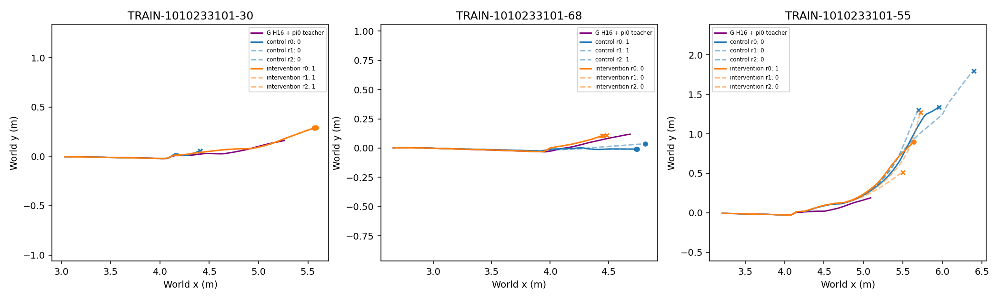
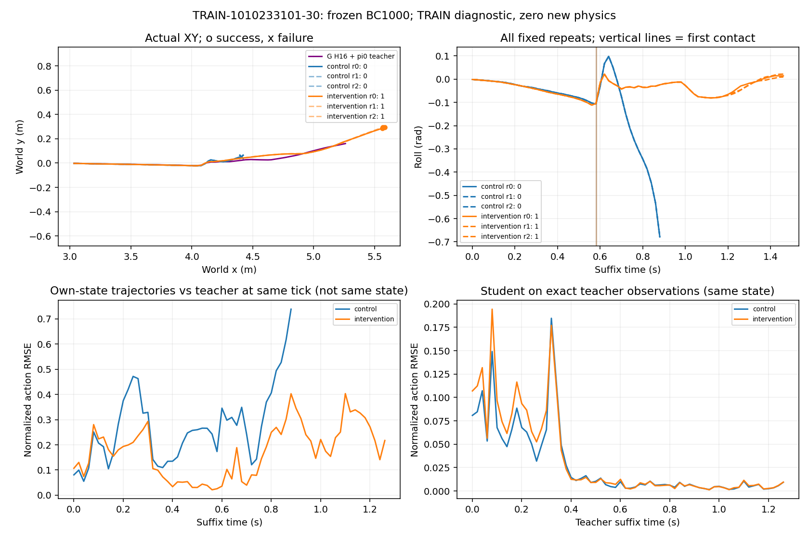
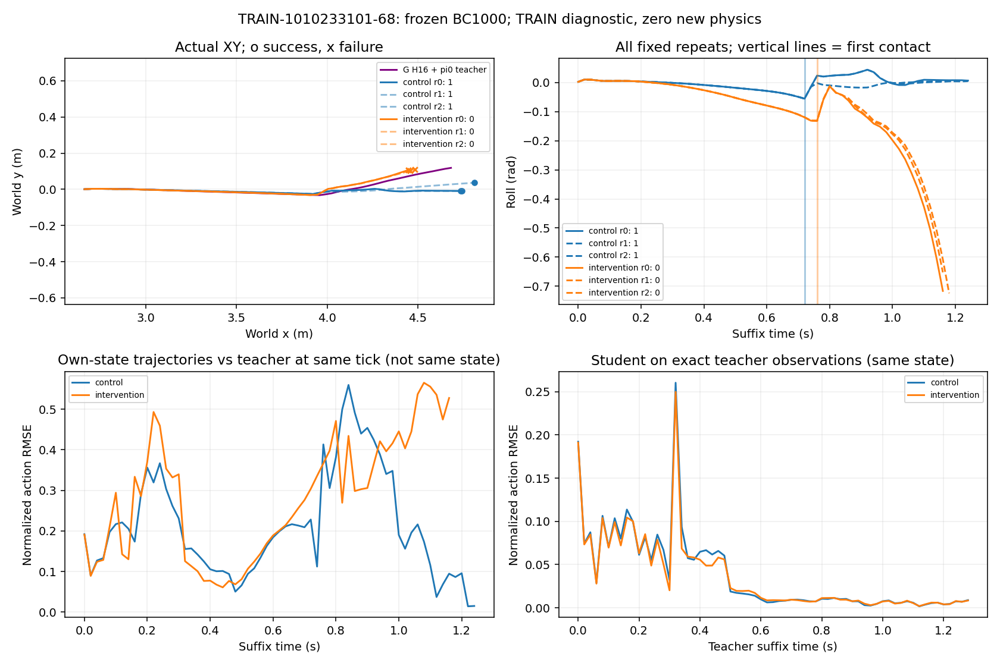
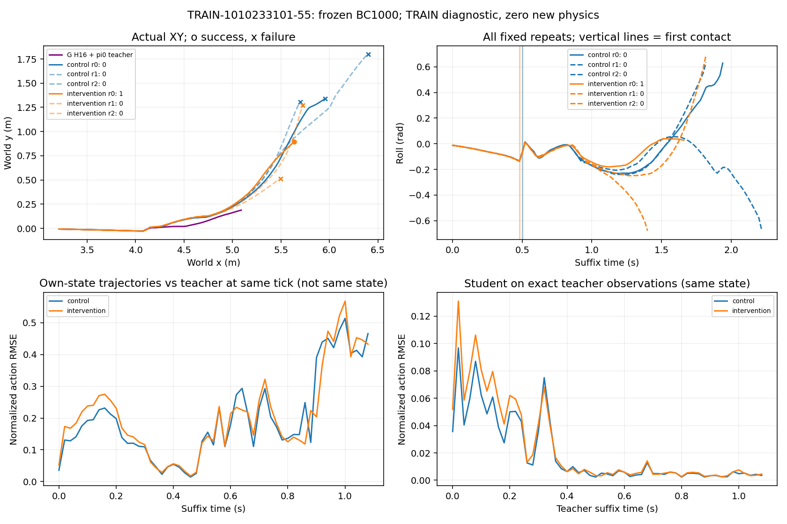

# T0：保存TRAIN数据的零物理诊断

工程门槛：**passed**；T1 allowed=`True`。冻结容差 `0.00559464097`。

本报告只做CPU推理与固定TRAIN梯度计算：新增物理0、参数更新0。通过只表示输入身份与执行动作链一致，不表示恢复能力提升。

|模型|旧525 MSE|新增228 MSE|keep6289 MSE|旧稳定学生自访MSE|
|---|---:|---:|---:|---:|
|control_0|0.0093994092|0.00650627|2.3711752e-15|0.0092622628|
|control_100|0.0038895874|0.0016158134|0.00075356704|0.0012875875|
|control_500|0.0021005345|0.00089999022|0.00057927009|0.00012020541|
|control_1000|0.0014039894|0.00084508458|0.00052950687|1.1686323e-08|
|intervention_0|0.0093994092|0.00650627|2.3711752e-15|0.0092622628|
|intervention_100|0.0038848767|0.0014458676|0.00066901739|0.0012909461|
|intervention_500|0.0022130639|0.00063132914|0.00052617875|0.00018396964|
|intervention_1000|0.001527919|0.00050203658|0.00048507902|7.7660447e-05|

旧稳定学生自访观测固定选择旧BC1000四个三次成功根的第二次确认轨迹；只作为TRAIN诊断参考，未加入学习。新增示范与原示范分开，避免变动分母掩盖误差。

|根|旧BC1000三次|新BC1000三次|旧/新各自闭环prefix16 RMSE|
|---|---|---|---|
|TRAIN-1010233101-30|[0, 0, 0]|[1, 1, 1]|0.280855/0.201877|
|TRAIN-1010233101-68|[1, 1, 1]|[0, 0, 0]|0.243512/0.293626|
|TRAIN-1010233101-55|[0, 0, 0]|[1, 0, 0]|0.162438/0.197321|

闭环轨迹同tick的动作差不是同状态误差。各根分歧图同时展示精确教师观测上的学生动作误差；接触及失败均保留真实终点。

`TRAIN_gradients.json`给出固定完整TRAIN分组梯度范数及夹角；没有执行clip、Adam或参数更新，不能冒充实际mini-batch梯度或容量证明。

机器入口：`T0_gate.json`。详细来源/身份：`input_identities.json`。动作链：`execution_chain.json`。共同观测分组误差：`cross_inference.json`及`cross_inference_overview.csv`。不复制模型、全部观测或物理轨迹；由锁定原始来源可重算。

状态分歧按各原始分量1e-6描述，保留qpos/qvel/观测的原单位；它不采用动作重建验收容差，也不是物理显著性判据。

独立CPU→保存动作最大差0.000741865486，原生Brax CPU→保存动作最大差0.000741809607；独立CPU→原生CPU最大差2.68220901e-07。共同CPU与保存执行之间存在差异，不能据此精确归因某个GPU内核。冻结门槛公式保持不变。

门槛失败阻断T1；不得调大已冻结容差、重试物理到成功或打开TEST。原始模型、数据和轨迹均未覆盖。
