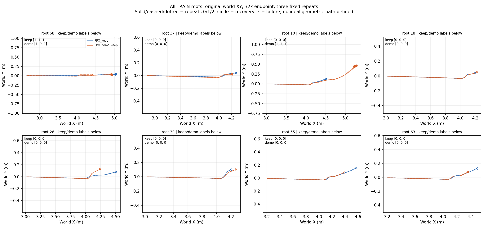

# T1完整机制筛查结果：未通过，正式矩阵暂停

## 首先看全覆盖实际XY

[完整DEV A](xy_DEV_A.png) · [B](xy_DEV_B.png) · [C](xy_DEV_C.png) · [D](xy_DEV_D.png) · [solver7根](xy_solver_roots.png) · [四池诊断](xy_reset_pool_diagnostics.png)

没有人为几何参考；XY为原世界坐标、米、等比例，轨迹在真实终点停止。实线／虚线／点线为固定三次，圆点成功、叉失败。DEV图含同身份π0；TRAIN／solver快照图含两臂。四池仅诊断，不计入成功率。

## 结论与分母

|项目|π0|PPO＋keep|PPO＋demo＋keep|
|---|---:|---:|---:|
|DEV三次各64|38/41/47|56/56/57|54/55/54|
|DEV稳定成功/64|35|56|54|
|DEV歧义/64|14|1|1|
|相对稳定π0：新增/旧损失/净增|—|10/3/+7|6/0/+6|
|稳定TRAIN/8|未重测|1|1|
|solver首评/7|未重测|1|1|

完整机制门槛false：未达到TRAIN≥5且高于对照，required根未保留、solver未达3、DEV净增未高于对照。B/D三次任意两次>5pp确认退化未触发；教案B第三次警告保留。总体保持guard通过只是本小DEV工程门，不是正式非劣统计或零遗忘。π0存在14个mixed条件；稳定分类与各次总成功分开，三次复核不是三训练种子。

|TRAIN根|PPO＋keep|PPO＋demo＋keep|
|---|---|---|
|TRAIN-1010233101-68|[1, 1, 1]|[1, 0, 1]|
|TRAIN-1010233101-37|[0, 0, 0]|[0, 0, 0]|
|TRAIN-1010233101-10|[0, 0, 0]|[1, 1, 1]|
|TRAIN-1010233101-18|[0, 0, 0]|[0, 0, 0]|
|TRAIN-1010233101-26|[0, 0, 0]|[0, 0, 0]|
|TRAIN-1010233101-30|[0, 0, 0]|[0, 0, 0]|
|TRAIN-1010233101-55|[0, 0, 0]|[0, 0, 0]|
|TRAIN-1010233101-63|[0, 0, 0]|[0, 0, 0]|

## 已执行的继续工作：零新增物理／学习

1. 保存标签和48条TRAIN轨迹逐条对照、重算门槛、source locks及模型/normalizer/context校验，全部通过。完成全64 DEV×3模型×3重复和solver7根XY，保留反例。
2. 用7291条固定TRAIN共同观测比较0/16k/32k；keep目标独立π0确定性重建，绝不是零动作。教案old MSE .0093994→.0085829，new .0065063→.0058077，keep .00007364；对照old .0094865/new .0065304/keep .00004638。全体逐帧MSE与按根权重MSE不同，不能混报。
3. 固定六个endpoint做T0同合同TRAIN梯度，零参数更新。教案32k原/新指导余弦 .9731，新增指导/历史BC稳定轨迹 .9718；新增指导/keep −.6112、原指导/keep −.6800。这不同于历史BC点附近的冲突，不证明Actor容量不足。π0 keep梯度近零，该处余弦不解释。

真实80次更新中，weighted demo/PPO actor梯度范数中位1.8815%，范围.8231–2.9209%；37/80余弦负。只能说demo相对梯度小且有部分方向冲突；全局clip中位.00147、critic大，不能忽略Adam而宣称clip造成失败。旧教案与新教案方向总体一致，下一步应核对优化如何把这些梯度转成参数和行为，而非直接重做BC扫描。

[逐轨迹终点与失败理由](train_trajectory_metrics.csv) · [共同观测MSE](common_observation_errors.json) · [冻结TRAIN梯度](TRAIN_frozen_gradients.json) · [实际更新图](actual_update_diagnostics.png) · [原始身份](trajectory_provenance.json) · [机制判定](mechanism_decision.json) · [重算摘要](summary.json)

## 成本与边界

T1_002实际charged328308，prior1123052含001失败200，D2累计1451360/2000000；耗时1591.64s。评价/诊断已分active84260+padding173448，另70600为训练/工程计费未拆；无失败预留。本次分析物理0、优化0、TEST0，不耗剩余预算。原001与002和所有checkpoint不覆盖。
候选published=null，不采用学生；正式15运行、最终TEST、目标sim2sim未启动。教师比Noise有效及完整反馈有效仍没有证据。

## 接下来如何继续

先完成一个新有限方案：固定32k检查点和TRAIN数据，捕获真实同批次PPO/demo/keep/critic梯度与Adam前后state，离线比较各目标对真实参数增量的贡献及接触前动作偏差；每次反事实独立clone，不能把离线目标差视为闭环收益。现有日志只有范数/夹角，没有完整minibatch梯度与Adam前state，因此此项仍待新的工程采样合同，未执行。
若要改优化，用与旧T1分开的版本、同π0/critic与数据，声明具体算法变化及有界新预算；不把剩余548640自动用完，不改success、physics、网络、不换种子找阳性。当前没有足够因果证据直接选“加大demo”“分开clip”或容量扩展。

## 复算指令

从worktree仓库根，使用JAX_PLATFORMS=cpu、PYTHONPATH=JIT/src和既有venv Python运行`analyze_saved_t1.py --run <原run> --output <新输出>`；另两份plot脚本与冻结grad脚本使用文件内声明的同一只读run。脚本不加载模拟环境、不调用优化器，也不开放TEST。
临时raw saved_review_001的keep placeholder未填，仅派生调试记录；唯一采用本报告对应saved_review_002，不覆盖原记录。

绘图语义已核验：DEV collect trace的`mask`只标记三步脉冲，完整物理观察窗口必须使用`prefix_mask`；全部DEV图按完整prefix_mask截取，并逐条件重建成功标签校验，不把扰动三步当完整轨迹。TRAIN evaluate trace则使用`mask`，按其steps与终点标签校验。

重复性限制补充：[名义完整起点分歧收据](nominal_repeat_variability.json)显示首次64世界批次中A组16份初始qpos/qvel一致、请求脉冲全零，但第一步后qvel已出现大于1e-6差异，观测随后分歧。此为保存数据的描述性结果，不能确定其数值内核成因；不把π0的14个mixed条件当稳定旧成功／失败，也不把相对“稳定π0”的净增扩写成总体泛化增益。下一工程归因方案须同时保留真实物理输入/状态分歧，不能只分析loss或根据单次最好视频判断。
