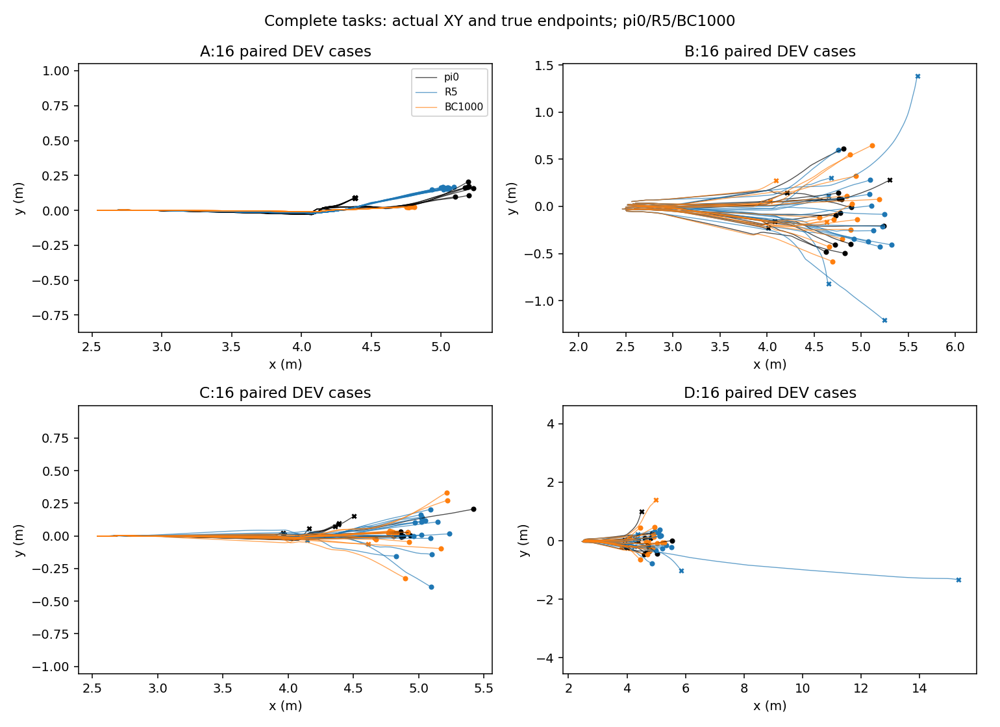
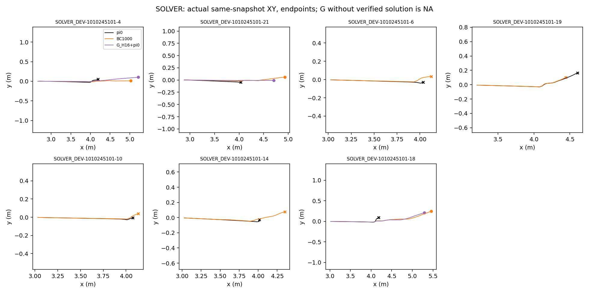

# B_self_visit_demo_001：最终有界阶段证据

原始运行：`/home/qy/DVGC/JIT/runs/experiments/retention_next_20261010/B_self_visit_demo_001`。锁定代码 `0f4ed45d506fcfa816eb3250eea57c19e33405ed`。本目录仅从保存产物派生，未运行仿真或训练。

完成1000/1000次BC更新；候选为update1000。CPU完整状态审核验证0/100/500/1000步与Adam计数一致、fresh π0/Adam、normalizer与critic冻结。PPO/E/G更新均为0；未发布策略、未启动下一阶段。

下表全部是首次评测。TRAIN分母8、SOLVER_DEV分母7；A/B/C/D各16个DEV数值案例。G/L表示相对同一首次π0基线的新成功/丢失，不是相对旧学生。控制为B_keep_coverage_003同一更新节点；对照不是独立训练种子。

|更新|组别|TRAIN|SOLVER_DEV|A/B/C/D|新增/丢失|净增|
|---|---|---:|---:|---|---|---:|
|0|旧keep coverage|0/8|0/7|7/12/8/11|0/0|0|
|0|自访示范|0/8|0/7|7/12/8/11|0/0|0|
|100|旧keep coverage|3/8|1/7|16/12/13/10|21/8|13|
|100|自访示范|3/8|0/7|16/12/12/11|21/8|13|
|500|旧keep coverage|3/8|2/7|16/13/15/10|20/4|16|
|500|自访示范|4/8|2/7|16/12/15/11|20/4|16|
|1000|旧keep coverage|5/8|3/7|16/14/15/10|22/5|17|
|1000|自访示范|5/8|3/7|16/13/15/12|20/2|18|

选中update1000的首次DEV为56/64（π0为38/64），保留36、新增20、丢失2（B_06、C_10）。B/D门槛未触发，因此本阶段完整DEV配对重复为 **NOT_RUN**，不能将首次丢失5→2写成稳定遗忘改善。旧coverage的重复结果来自独立历史复核，不能填入本阶段重复列。

|TRAIN根尾号|旧coverage三次|本阶段三次|本阶段判定|
|---|---|---|---|
|68|[1, 1, 1]|[0, 0, 0]|stable_failure|
|37|[1, 1, 1]|[1, 1, 1]|stable_success|
|10|[1, 1, 1]|[1, 1, 1]|stable_success|
|18|[0, 0, 0]|[0, 0, 0]|stable_failure|
|26|[1, 1, 1]|[1, 1, 1]|stable_success|
|30|[0, 0, 0]|[1, 1, 1]|stable_success|
|55|[0, 0, 0]|[1, 0, 0]|ambiguous|
|63|[1, 1, 0]|[0, 0, 0]|stable_failure|

稳定成功仍为4/8。root30从旧coverage三次失败变为三次成功，同时root68从三次成功变为三次失败；root55=[1,0,0]。这是局部吸收与能力交换的证据，不能声称恢复能力可靠提高或遗忘已解决。root30亦不是整个历史谱系首次成功。

数据仅改TRAIN示范支持：旧525帧+4个合格自访query的228帧=753，keep6289帧冻结。新增query是18@j4、30@j4、55@j8、55@j12；不含DEV回流。同祖先均衡及轨迹均衡使新增采样权重占比为5/24，帧比例228/753不是采样权重占比。

实际新charged=147537（active72892+padding74645），prior975315，累计1122852；新上限645200，累计声明上限1620515。阶段声明至完成1262.972s，启动至完成1218.506s，低于10800s上限。64个子收据全部completed。

TensorBoard http://localhost:6031 已核HTTP200，DEV/B_reward_per_transition第1000步为14.549785614013672；BC/loss为0.0020397743210196495（demo0.001749503193423152、keep0.0002902710693888366）。这是开发物理评估奖励与BC损失，不是PPO训练奖励。完成通知已有delivered记录且delivery_errors=[]；不代表已确认用户看见弹窗。

图复用qpos世界坐标前两列，以米显示、等比例且在真实终点停止。图中BC1000为首次轨迹，不能代替三次标签表；G曲线是H16+π0组合教师，只在已有验证解的根显示，不能称部署Actor成功。

限制：单个训练初始化种子；TRAIN、已用SOLVER_DEV、已用全DEV分别列出；没有最终TEST、独立训练种子泛化、sim2sim或实车验证。A16为一个名义物理初态的16个数值拷贝。无需为填表补跑任何评测。

机器可核数据：`independent_final_audit.json`（含来源与身份）、`matched_update_comparison.json`、`TRAIN_repeat_labels.json`、`paired_retention.json`、`BC_full_state_verification.json`、`summary.json`。原始逐步NPZ路径保留在summary/conversion_matrix/trajectory_diagnostics。
