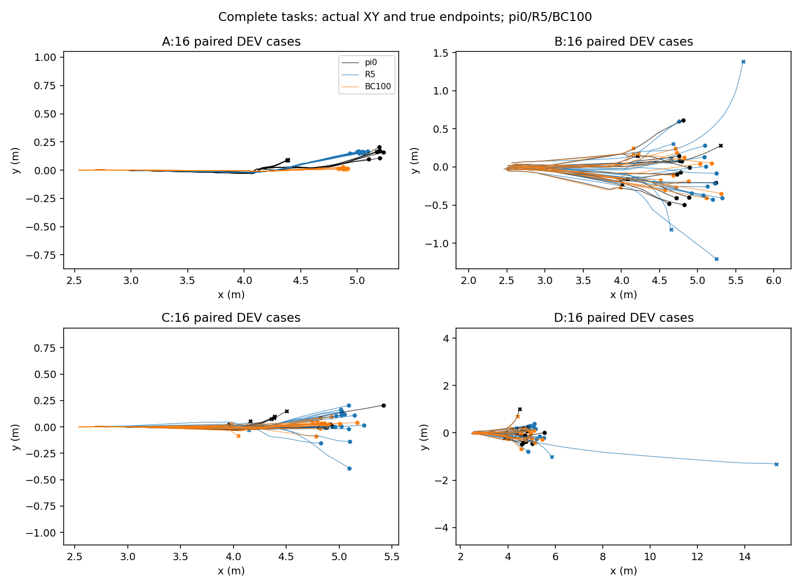
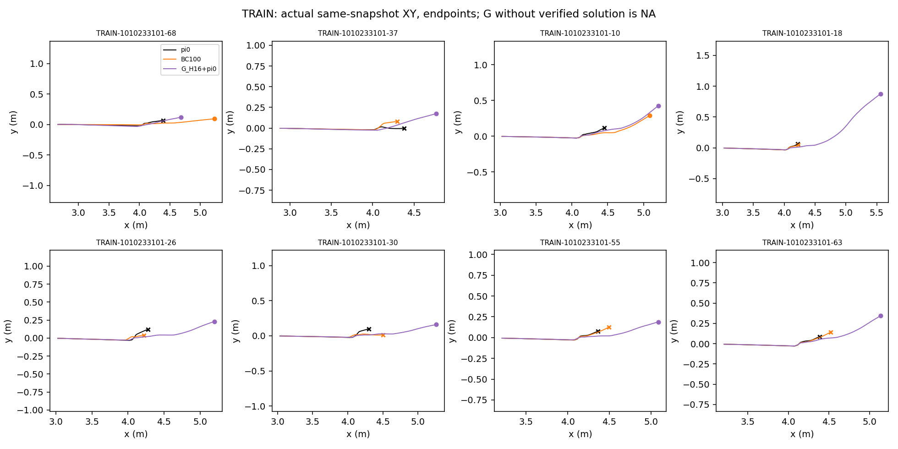
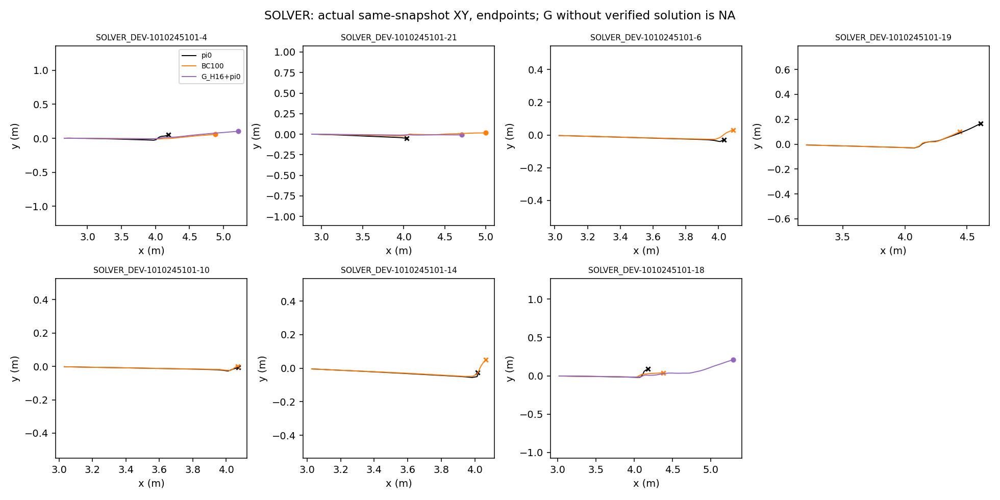

# B weight ratio：keep/demo=1.5/0.5 未通过保持性警戒

已执行一次独立有限试点。BC100在B格（随机初态、无动作扰动）触发并确认原有保持性警戒，提前停止，未达到500/1000/2000。learner_last=BC100，阶段候选=零更新π0；冻结全局best_dev_candidate仍为R5，published_policy=null。回退π0不算学习改善，不采用被拒BC100。不继续扫权重/PPO/E/G/200轮。

## 固定数据、同更新数比较

只把keep/demo=1/1改为1.5/0.5。固定同一合并keep6289帧（TRAIN成功轨迹、名义/随机组50/50、祖先/轨迹均衡）、原8G教案525帧、每来源batch256、同seed1010267101和sampling keys。均从原始π0/fresh Adam/RNG起步，Actor-only Adam1e-5/clip1，normalizer/critic冻结，网络/观测/权限/物理/奖励/H16/成功判据不变；不从BC2000/R73/R74或GPU微验状态开始。demo+keep本身已经是双来源监督，未增加重复蒸馏项。π0/R5完整物理基线和同布局0更新15根轨迹按身份锁复用；0新增keep、0额外基线仿真。DEV未回流TRAIN，未打开TEST。

|BC100同节点|keep/demo1/1|keep/demo1.5/0.5|
|---|---:|---:|
|TRAIN教案首次独立吸收 /8|3|2|
|未见SOLVER_DEV独立成功 /7|1|2|
|A：名义、无扰动 /16|16|16|
|B：随机、无扰动 /16|12|11|
|C：名义、固定请求 /16|13|14|
|D：随机、同一固定请求 /16|10|13|
|首次π0新增/丢失/净差|21/8/+13|22/6/+16|
|固定复核新增/丢失/净差|16/8/+8|17/7/+10|
|原规则资格|通过该节点警戒|B格确认退化，拒绝|

新BC100 B首次π0/学生12/11，复核13/12；每格16题，一题6.25个百分点，沿用原>5pp警戒及一次配对复核，不改阈值。警戒是预先声明工程选模规则，不是统计显著性检验。原1/1完整阶段曾完成2000、选1000：TRAIN5/8（稳定4/8、歧义1/8）、SOLVER_DEV3/7、首次旧损失5、复核4；此为已保存参照，不能与只训练100的新试点直接归因于权重。

## 老师有解、学生吸收与未见迁移分别记录

|TRAIN root后缀|G固定验证解|1/1 BC100首次学生|新BC100首次学生|冻结R5原标签|
|---|---:|---:|---:|---:|
|68|1|1|1|1|
|37|1|1|0|1|
|10|1|1|1|0|
|18|1|0|0|1|
|26|1|0|0|1|
|30|1|0|0|1|
|55|1|0|0|0|
|63|1|0|0|0|

TRAIN8都有合格G解；新BC100首次只吸收68/10，2/8，未复核这个被拒节点，不称稳定学会。固定2次TRAIN重复按原规则只用于阶段候选BC0，8根均[0,0,0]，所以本次没有合格已训练候选。R5原标签失败的根为10/55/63；新BC100在10首次成功，在55/63失败。18/30/55是覆盖试点BC1000的稳定失败根；其中18/30的R5原标签为成功，不能写成R5原本也不会。训练仍覆盖全部8根。历史学生曾学会的新恢复技能与π0原始旧技能分开：同BC100，root37从1/1成功变为新比例失败；原1/1已选BC1000稳定根37/26在新BC100失败属于不同训练长度下的历史技能差异，不混称π0旧能力遗忘；root30仍失败，未把它重记为新增。

2026-10-11只读证据复核更正：上一版误写“R5原本失败的18/30/55”，现按原始`B_checkpoint_results.json`及`weight_comparison.json`的R5字段更正。R5在root10的原标签为0，但历史`B_002/report_001/summary.json`的固定R5复核已有成功，因此“原标签失败”也不能写成“稳定不会”。本更正不改变本次BC100原始结果、保持警戒、费用或拒绝决定。

|SOLVER_DEV root后缀|G固定验证解|新BC100独立学生|冻结R5原标签|
|---|---:|---:|---:|
|4|1|1|0|
|21|1|1|1|
|6|NA|0|0|
|19|NA|0|0|
|10|NA|0|0|
|14|NA|0|0|
|18|1|0|1|

3根G有解的DEV中学生成功4/21、失败18；其余4根老师无解写NA，学生仍全部评价且均失败。2/7是未见root的开发迁移，和2/8已见吸收、四格新增22均为不同分母，不是独立TEST成功。

## 旧损失、数值重复与闭环失败

|新BC100|首次新增/丢失|复核新增/丢失|两次都丢失|π0标签翻转|学生标签翻转|
|---|---:|---:|---:|---:|---:|
|A|9/0|7/0|0|12|0|
|B|3/4|2/3|2|1|3|
|C|6/0|4/0|0|2|0|
|D|4/2|4/4|2|0|2|

两次都损失B_06/B_14/D_07/D_14，原始轨迹首次侧倾越限分别在有效接触后49/48/57(复核55)/48控制tick；禁止接触未先发生。D_05复核在首次有效接触41之后、113控制tick俯仰越限，核对原始metric/terminal/pitch_limit，非只看end_code。精确物理substep未保存，写UNKNOWN。π0重复翻转12/1/2/0，学生0/3/0/2；特别是名义数值重复不稳，不能用首次总净增宣布可靠恢复或把重复当独立训练种子。所有DEV失败仅分析，不成为TRAIN。

实际100次同mini-batch加权Actor梯度：demo/keep平均norm0.078422/0.049032，cosine均值-0.823744、99%为负；实际共同裁剪scale全部1，Adam参数增量norm均值0.002334。第一更新原始demo/keep loss与1/1完全一致，实际加权梯度为0.5/约1.5倍；固定历史probe没有冒充优化器贡献。该证据不证明容量不足，也不证明改变权重可以消除闭环偏移。原PPO共同裁剪问题未在纯BC中另行改动。

## 身份、预算和交付边界

执行源码3cc875e6fb88a2d65c2d820032c96f7aac579b99；原始π0 Actor a06acbc8… / normalizer db84aad7…，冻结R5 Actor db2f3deb… / normalizer c9b365c7…，各自配对。实际keep数据SHA a5156fff73e99d21478a87ab95a2bcda8e8b874268ce123dfe0bbfea7f4c11ba；receipt abd681817f6f6a458abb49bc476c26c064954c525241377ca6341e7f99e4864e；完整输入身份、代码/输入锁、worker读取见summary及comparison。独立schema jit_retention_B_weight_ratio_v1、独立目录/授权/3h时钟；原12h历史start不改。

actual-layout新增预算824000，实际101416（active37003、padding64413）；此前D2累计776098，总计877514/2000000。监督更新100/最多2000，PPO/E/G更新0；运行735.7s，未用剩余额度继续。0/100完整BC状态的Adam count/moments、RNG、绝对监督时钟、Actor导出及冻结stats/critic逐项核验通过；500/1000/2000因警戒早停未产生，不是缺失恢复，不声称resume已经实现。TB6029已核验当前DEV reward及实际梯度/参数增量标量step100；watcher完成通知成功。CPU定向38项通过只证明实现合同，不替代物理结果。

最有信息量的下一试验仍选B：在固定已接受1/1 BC1000的TRAIN自身访问状态（全部8根，j=4/8/12）查询恢复指导，固定剩余H16-j和π0尾部，G16+source搜索后固定赢家两次完整布局重放；不拿DEV失败训练、不平均所有老师动作。独立提案最多544000charged/3h、0学生/PPO/E/G更新，若获授权，D2累计最坏1421514/2000000。老师能救支持指导/分布偏移诊断；老师不能救说明教案覆盖/老师边界；经验证指导拟合后仍闭环失败再诊断学习通路。本次只提出这一诊断，不自动采标签或训练。停止本阶段、保留π0/R5；不从本次负结果推断容量不足，不再自动加keep或扫比例。

原始运行：`/home/qy/DVGC/JIT/runs/experiments/retention_next_20261010/B_weight_ratio_001`；完整报告`weight_ratio_report_0001/INDEX.md`。本目录为compact evidence，原轨迹/模型保留服务器。

[同更新数配对及15根老师—学生矩阵](weight_comparison.json) · [实际梯度与旧损失轨迹](diagnostics.json) · [原始俯仰事件核对](pitch_phase_check.json) · [完整BC保存状态审计](BC_full_state_verification.json) · [身份/预算/worker输入](summary.json)
