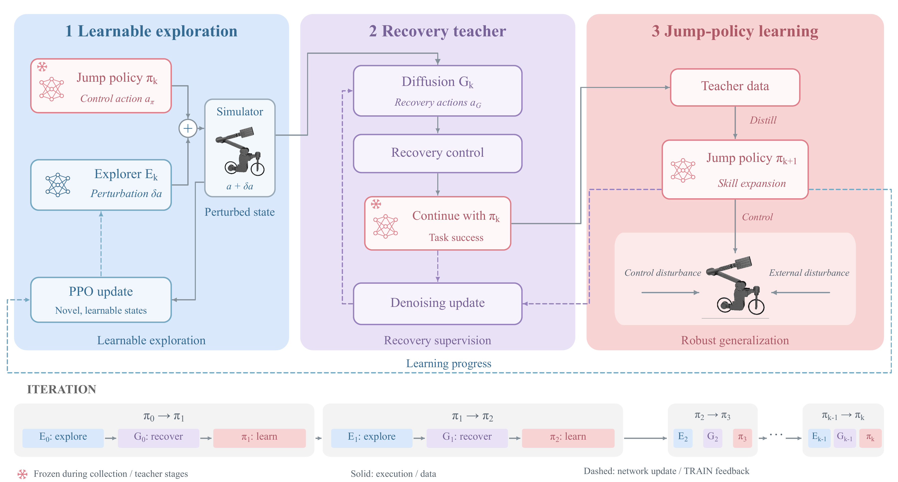
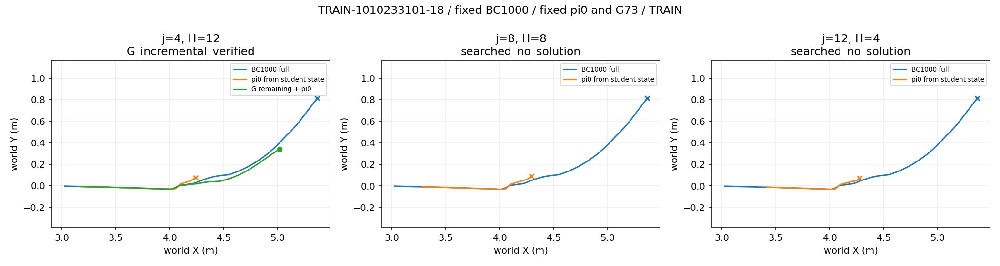
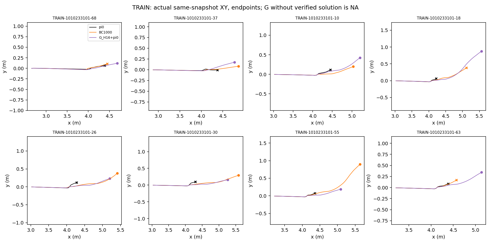
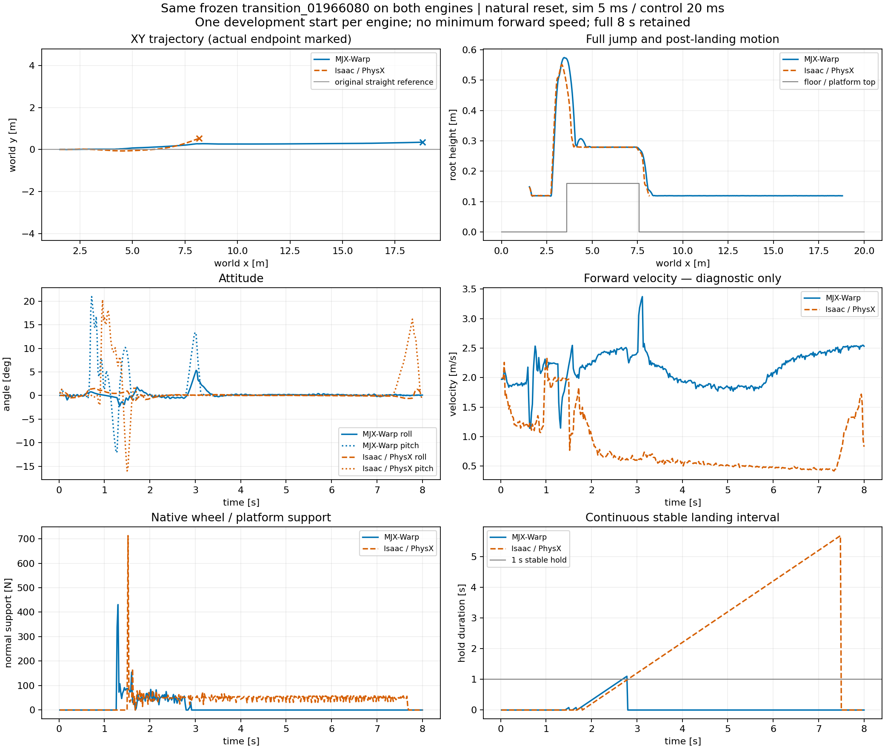

# JIT：面向跳跃策略能力扩展的可学习探索与生成式恢复指导

**中文论文工作稿 · 2026年10月11日**

作者：________　单位：________　拟投稿期刊／会议：________

> 阅读说明：本文按“可学习探索E—恢复教师G—跳跃策略π”的完整研究思路撰写。已有实验按原始证据填入；黄色“【待补P编号】”为尚缺的论文证据，不代表已得到相应结论。本文目前是供修改的研究草稿。正文中的开发集、确定性复核和独立训练种子严格区分。文末附证据索引和待补结果清单。

## 摘要

机器人跳跃策略在固定起点和常见扰动下取得成功，并不意味着其已经掌握偏离训练分布后的恢复行为。直接增加扰动强度可能产生大量当前策略无法处理、也难以转化为学习信号的状态。为此，本文研究一种由可学习探索、生成式恢复教师和跳跃策略学习组成的迭代框架JIT。探索器在冻结跳跃策略的动作上施加有界短时扰动，产生真实动力学可达的状态；条件扩散模型从扰动后状态生成短动作序列，经模拟器验证并交回冻结策略完成任务，形成带来源的恢复示范；学生策略利用合格示范与旧技能保持数据更新，并以独立闭环成功、新增能力和旧能力损失评价学习效果。框架进一步将策略学习进展反馈给后续探索与教师更新。

本文报告固定方法契约下的阶段性开发证据。对160个新采集初态筛查后，选取16个TRAIN与7个SOLVER_DEV稳定失败根进行同状态教师比较：生成教师与有色噪声教师在固定赢家重复验证资格上呈互补，生成教师形成8条合格TRAIN教案。在8个学生训练根的24个自身访问状态查询中，12个查询满足源策略三次失败、固定生成教师三次成功；其中4条指导来自3个历史稳定失败祖先。新增自身访问指导后，学生三次复核的稳定吸收仍为4/8；一个失败根被修复，同时一个原成功根丢失。完整开发集首次评测为56/64，相对原π₀新增20例、丢失2例，但该配对改善尚缺重复确认。本文据此支持“有限状态上存在可验证恢复指导”及“指导到学生的转化可被分解测量”，尚不支持扩散必要性、可靠无遗忘或最终单策略泛化优势。多种子等成本比较与统一口径迁移评价保留为明确待补实验。

**关键词：** 机器人跳跃；可学习探索；条件扩散；恢复指导；策略蒸馏；能力保持

## 1 引言

跳跃控制要求机器人协调轮系与关节驱动，并在离地、腾空、接触和落地后恢复之间完成状态转换。训练得到的名义策略通常只覆盖有限的状态分布：在常见初态上能够跳跃，不保证执行器扰动或接触误差使轨迹发生偏移后仍能完成任务。本文关注如何利用已经具备跳跃能力的策略，逐步发现其尚未掌握但存在恢复方案的状态，并将这些恢复行为转化为同一部署策略的能力。

这一问题存在三个相互联系但不能混淆的环节。第一，探索需要产生有学习价值的状态，而非仅获得更远、更偏或更容易失败的轨迹。第二，当前策略失败不等于该状态不存在可行恢复动作，恢复教师需要提供真实执行后可以完成任务的指导。第三，教师成功不能直接计入学生成绩：学生必须在没有教师介入的情况下独立成功，同时记录是否失去了原有能力。

基于这一划分，JIT将探索器E、生成教师G和跳跃策略π分开建模。E负责改变状态分布，G负责将部分失败状态转化为带验证标签的恢复示范，π负责把这些示范吸收到闭环控制中。部署目标为独立跳跃策略；教师候选搜索发生在训练侧。旧策略既是教师短桥接后的尾部控制器，也是能力保持的参照。最终评价仍从声明的完整起点进行，不能以中间快照恢复或教师辅助结果替代完整任务表现。

本文的工作包括：建立E—G—π及学习进展反馈的统一方法表述；实现恢复示范的来源、尾部策略、交接时序和固定赢家复核；给出教师可解性、学生吸收、旧能力损失及自身状态诊断的分解证据。当前稿件不将“实现了模块”写成“证明了该模块必要”。【待补P1—P4】完整框架相对等成本基线的优势，将由第6.6节预留的主实验与消融结果支撑。

## 2 相关工作

**动态技能与跳跃学习。** 自行车机器人动态技能已有强化学习研究。Bicycle Acrobatics展示了多种特技及策略组织；LineRides研究了空间引导线下的特技学习。[1,2] 因而本文不以“首次实现自行车跳跃”为贡献，研究重点是既有跳跃策略的恢复能力扩展及其证据链。

**残差探索与课程学习。** 残差强化学习通过组合基础控制与学习信号利用已有控制能力。[3] PPO提供了可用于策略更新的优化方法。[4] 新颖性驱动探索和自动课程分别从访问分布和学习难度组织经验。[5,6] JIT借鉴这些思想，但探索奖励产生了新状态，仅说明访问分布发生改变；这些状态是否可恢复、是否可被学生掌握，仍需后续实验验证。

**扩散动作模型与恢复示范。** 去噪扩散模型通过逐步去噪学习数据分布，Diffusion Policy将条件扩散用于机器人动作序列建模。[7,8] JIT使用条件扩散生成有限时域恢复动作，并通过物理执行与冻结策略接续筛选示范。本文不将扩散直接作为部署控制器，也不由建模形式推断其优于更简单的动作搜索。相同候选数的生成教师与有色噪声对照，以及最终学生的等总成本比较，需要分别报告。

**闭环模仿与能力保持。** DAgger指出，策略自身诱导的状态分布与教师示范分布可能不同。[9] 这一问题为查询学生自身访问状态提供了方法动机，但不能直接证明本任务的误差原因。本文将“老师在学生状态可救”“学生能拟合指导”和“独立学生闭环改善”分开检查，并用逐题新增／丢失计数描述能力变化。本文的有限示范补充不声称满足DAgger理论的全部前提，也不提供无遗忘保证。

## 3 问题定义与评价语义

### 3.1 任务、完整上下文与策略

设完整仿真与控制上下文为χ，包含物理位置与速度、观测历史、上一动作、执行器状态、事件历史、阶段标记、随机数状态以及任务时钟。Actor仅使用其声明观测o，特权信息不直接作为部署Actor输入。将离散控制系统抽象为：

$$
χₜ₊₁ = F(χₜ, Map(aₜ)),　oₜ = O(χₜ),　aₜ ∈ [−1,1]⁴。　(1)
$$

当前保持性实验每20 ms施加一次动作，物理步长5 ms。四个归一化动作通道按顺序为转向、后轮驱动、髋关节和膝关节；执行器位置／速度目标映射、范围及关键帧中心的绝对关节目标语义与checkpoint共同冻结。恢复指导改变控制动作，不直接生成或篡改物理状态。完整上下文恢复保留声明字段，但不等价于模拟器所有内部接触缓存的逐位恢复。

本文使用S(π,χ)表示策略在给定初始上下文下是否满足冻结成功判据。近期retention实验的成功要求有效落地后连续25个控制步保持稳定，包括前向速度不低于0.5 m/s、侧倾绝对值不超过10°、俯仰绝对值不超过15°、轮间隙／穿透和机身接触条件合格；并排除同时发生的物理失败与超时。[E8] 这一定义不同于仅记录首次落地，也不同于第6.5节sim2sim所用的1 s稳定窗口。

### 3.2 新能力、保持性与教师辅助能力

在同一评价条件集合I上，记原策略与学生的成功标签分别为y⁰ᵢ和yˢᵢ。定义新增成功G、旧成功丢失L和净差Δ：

$$
G = Σᵢ 1[y⁰ᵢ=0 ∧ yˢᵢ=1]，L = Σᵢ 1[y⁰ᵢ=1 ∧ yˢᵢ=0]，Δ = G − L。　(2)
$$

成功总数增加允许G与L同时非零。因此，总成功率、净差和保持率需要同时说明，不能互相替代。若旧策略成功样本数为N₀，条件保持率为(N₀−L)/N₀。未知或缺失标签另列，不计入有效二元配对；N₀=0时保持率记NA。这里的标签依赖声明的数值布局和重复协议；重复标签翻转单列为歧义，不能全部归因为真实遗忘。

教师系统T由短动作桥接与冻结π尾部共同组成。只有原策略失败、T通过物理复核的状态，才构成相对该原策略的增量指导。学生能力仍用S(πˢ,χ)单独计算。某个历史学生曾经成功、当前学生失败，属于历史技能回退；当π₀本来就失败时，不能将其记成π₀旧能力损失。

### 3.3 数据角色与证据单位

TRAIN可用于探索、教师拟合、学生监督和自身访问状态查询；SOLVER_DEV用于固定恢复初态上的开发排序；完整DEV用于配对能力变化与保持性警戒。最终TEST尚未开启。多个时点来自同一祖先、同一初态的确定性复核、同一训练checkpoint下的大量环境回合，均不等于独立训练种子。文中所有成功数同时注明分母和数据角色。

## 4 JIT方法

### 4.1 总体框架与冻结关系

图1使用作者提供的原始框图。每轮先冻结当前跳跃策略πₖ，探索器Eₖ产生真实扰动后状态；恢复教师Gₖ提出短动作序列，经物理执行后交回πₖ完成任务；合格数据用于训练候选学生πₖ₊₁。更新后的策略能力与学习进展形成下一轮反馈。图中的“Skill expansion”和“Robust generalization”表示研究目标，不能直接作为实验证明。

<!-- landscape -->

**图1. JIT总体方法框图。** 原图来自作者提供的JIT-core-method-network-icons.pdf，内容未修改。实线为执行／数据通路，虚线为网络更新／TRAIN反馈，雪花标记表示相应采集与教师阶段冻结。文中的教师验证和学生保持检查是这些通路的执行与评价约束。对反馈、能力扩展及泛化的有效性证据见第6节；框图本身不是有效性结果。
<!-- portrait -->

### 4.2 可学习探索

第k轮采集时冻结πₖ，探索器根据特权状态与历史邻域证据x，输出高斯分布的均值μᴱ(x)与对角方差σᴱ²(x)；采样潜在动作z后经tanh变换得到有界扰动。令mₜ表示本回合唯一的三步扰动窗口，则实际执行动作为：

$$
δaₜ = 0.25 tanh(zₜ)，　aₜ = clip(πₖ(oₜ)+mₜδaₜ,−1,1)。　(3)
$$

这里πₖ(o)指归一化确定性动作；记录请求扰动和裁剪后的实际扰动。当前连续协议按0、5、10、15四个控制步起点调度窗口，其余时刻由冻结跳跃策略控制。探索发生在控制动作空间，不改变质量、摩擦或成功判据。

R73实际使用邻域探索器：原始输入386维，由106维特权状态、16×17邻域条目及8个统计量组成。邻域条目经编码与掩码平均形成64维摘要，再与状态／统计拼接为178维，输入三层128单元ELU Actor和独立Critic。邻域证据区分当前源策略成功／失败、历史策略成功和历史已验证教师成功；在本批采集前冻结，不读取本轮尚未得到的学习结果。[E9]

探索PPO使用本轮新行为、潜在动作、行为概率与同根延迟反馈，γ=λ=1；当前声明4个优化epoch、概率比clip=0.2、目标KL=0.01。未执行动作、填充和未知标签不参与更新。当前learned-only协议uniform_episode_fraction=0；D1的噪声教师是独立对照，不应误画成当前E采集内的一条20%随机分支。

**网络接口（已核对R73执行配置）**

|模块|主要输入|网络／输出|用途|
|---|---|---|---|
|跳跃Actor π|76维：3×25真实历史＋jump_signal|256×3；tanh-normal四维归一化动作|独立闭环控制|
|跳跃Critic|106维特权观测|256×3；标量价值|PPO训练|
|探索器E|386维原始邻域输入→178维头输入|128×3 ELU Actor／Critic；四维扰动|训练侧状态探索|
|生成教师G|归一化76维条件、噪声时刻、16×4带噪序列|1D U-Net通道64/128/256；同形状噪声预测|恢复动作序列生成|

当前观测中名为estimated_forward_velocity的字段在仿真实现中使用真实根部前向速度；从仿真走向实际部署时，其测量／估计接口仍需验证，不能仅凭字段名称称完全可部署。

### 4.3 条件扩散恢复教师

以完整快照对应的76维Actor观测作为条件，生成教师输出H×4归一化动作序列U。本稿涉及的标准桥接窗口H=16，即0.32 s。条件扩散训练对成功动作序列加噪，并学习噪声预测：

$$
Uᵣ = √ᾱᵣ U + √(1−ᾱᵣ) ε，　Lᴳ = E[‖ε − εψ(Uᵣ,r,ō)‖²/64]。　(4)
$$

式(4)中ψ为G参数，ō为该G所绑定固定normalizer归一化后的观测；学生参数另记为θ。该式表述教师的去噪拟合目标，不能用该目标的下降代替恢复成功率。推理采用条件一维U-Net、100级余弦噪声日程、20步DDIM与EMA参数。R73保留last_valid完整状态，G-DEV去噪误差仅用于监测，不据此选本组评价最优模型。当前有限教师比较固定已完成G73，既不更新G，也不根据这组评价选择新的生成器。

教师从同一快照生成16个候选，并加入1条不执行生成前缀的冻结尾部πₖ源策略分支（近期D1／自身访问诊断固定为π₀），形成17世界完整布局。候选仅执行声明桥接窗口，然后不重置物理状态地切回冻结尾部策略，直至成功、失败或任务时限。近期D1／自身访问诊断先按固定规则选定赢家，再做两次相同布局复核；连续R73主线为搜索后一次复核，二者分别记录。不在复核后重新选一个恰好成功的候选。近期D1将独立π₀三次失败、源分支三次失败和固定赢家三次成功同时作为增量教案准入条件。在完整成功候选中，按全轨迹动作变化平方和最小、任务回报最大、候选编号最小的字典序固定赢家；动作变化从根的真实上一动作起算。

标准桥接可表示为式(5)，其中ℓ从本次查询根起算，t₀为根对应的任务控制时刻；局部桥接计数与原任务时钟分别保留：

$$
aᴛ(t₀+ℓ) = Uℓ（0≤ℓ<H）；　aᴛ(t₀+ℓ) = πₖ(o(t₀+ℓ))（ℓ≥H）。　(5)
$$

搜索与复核均保留失败候选。完整评价中未找到成功，仅表示当前教师、窗口与搜索预算未找到见证；未完成、非有限、工程错误或标签冲突不能改写为“物理无解”。实际费用同时包括成功、失败、填充和固定复核。

### 4.4 跳跃策略学习与旧技能保持

完整连续主线使用PPO任务学习与示范／保持辅助项共同优化学生：

$$
Lˢ = Lᴾᴾᴼ + λᴰ(u)Ldemo + λᴷLkeep。　(6)
$$

已执行R73每轮使用128,000条新的PPO转移；λᴰ从0.2降至0.05，λᴷ=0.2，两类辅助样本每批各256。学生PPO使用学习率3×10⁻⁵、clip=0.1、γ=0.995、GAE λ=0.97、全梯度上界0.75、128环境与unroll25。该主线中运行归一化统计会更新，退火按本轮统计计数增量计算；不能将后述纯BC阶段冻结统计的契约追溯到所有历史主线。

学生训练重置混合20%完整起跳起点与80%快照支持，快照内部pending比例0.5。完整起点训练脉冲为前三步，幅值0／0.1／0.25的混合概率0.2／0.4／0.4；这与E采集的四种起扰窗口不同。连续训练传递完整learner状态，但仿真回合从声明支持重置，不恢复上一训练阶段末的接触状态。[E9]

近期机制试验单独检验监督学习通路，不运行新的PPO、E或G更新。它从原π₀及全新Adam／随机数状态开始，冻结normalizer和critic；以真实执行前观测和真实执行动作训练Actor。示范损失与旧策略保持损失写为：

$$
Lᴮᶜ = λᴰ Eᴅ[‖πθ(o)−a*‖²/4] + λᴷ Eᴋ[‖πθ(o)−πref(o)‖²/4]。　(7)
$$

式(7)中的策略均表示包含各自身份绑定normalizer的tanh-normal确定性动作；πref参数与统计均固定并停止梯度，本次纯BC的学生统计也固定。两项分别使用验证恢复示范和独立TRAIN旧技能数据，不在同一困难状态上盲目平均两个老师的动作。当前控制组与自身访问示范试验均取λᴰ=λᴷ=1，两个来源每次各采样256帧；Actor优化使用Adam 10⁻⁵和全局梯度裁剪1。该保持项只约束采样状态上的动作一致性，不保证完整闭环无遗忘。

原始8个示范祖先等权，每条轨迹的桥接前缀与源策略尾部各占一半质量。自身访问试验在祖先内部均衡新旧轨迹。旧525帧观测与动作保持原值，但采样质量由重新分配决定：新228帧的采样质量为5/24，不能用228/753代表实际监督占比。

### 4.5 学生自身访问状态上的指导诊断

为诊断学生在教师已解决初态上的失败，先对预声明的全部8个TRAIN祖先运行完整学生闭环，在从原教师根起算的j∈{4,8,12}步完成后采集真实状态；成功与失败祖先均保留，后续示范准入才限制稳定失败祖先。随后从该状态比较源策略和固定生成教师，剩余桥接时长为H−j，原总交接时刻H不后移：

$$
Hⱼ = H−j，　j∈{4,8,12}，　H=16。　(8)
$$

G仍生成固定16步序列，仅执行其前H−j步后交回π₀，不改变网络输出长度。已终止或未到达的查询点保留在分母中，不临时替换时点。查询保留观测历史、动作历史、事件与任务时间。只有历史重复均失败、当前完整学生也失败、源分支三次失败而固定G赢家三次成功的查询，才进入本轮最小新增示范。新增数据采用预先固定的第二次复核完整成功后缀，不拼入此前学生失败动作。

该诊断用于区分：源策略本身可以接续、生成教师提供增量指导、当前有限搜索未找到解、重复结果歧义。只有继续训练后独立学生闭环改善，才能支持“补充自身访问状态指导改善转化”的解释。

### 4.6 学习进展反馈与有限迭代

框图中的反馈已在连续系列接线并执行，而不是三个网络端到端联合反向传播。探索器反馈来自同一TRAIN根的“学习前源策略标签→学习后学生独立标签”。对于证据有效且参与学习的根，当前质量奖励包括前0后1且允许继续采用时+2、前0后0时−0.1；施扰期间直接物理失败时奖励−2。若源策略在复核中已成功，就取消该根的新增奖励；teacher_success_bonus=0。因此，教师成功本身不是学生学习进展。[E9]

额外新颖项按冻结源Actor的物理格访问记录计算。令Cᵢ为本次实际扰动经过的格集合、Sₖ为该源策略历史访问集合、n(c)为本批对新格的重复访问数，有新格时：

$$
rⁿᵒᵛᵢ = (0.02/|Cᵢ|) Σ (1/n(c))，c∈Cᵢ∖Sₖ；　无新格时 rⁿᵒᵛᵢ = −0.02。　(9)
$$

式(9)仅适用于未直接物理失败、反馈有效且|Cᵢ|>0的回合；直接物理失败分支的新颖项为0、总奖励为−2，空格／未知情形按实际有效性掩码处理，不套用“无新格”的−0.02。新颖性只描述有限分辨率的访问统计，不是严格可达域。当前E反馈没有对完整旧能力集合施加统一回归惩罚，不能解释成自动无遗忘机制。

学生到G的反馈用于更新成功轨迹库。G按历史50%、本轮验证教师25%、本轮获连续采用学生的独立成功25%请求采样，空来源重新归一化；来源内再按祖先、轨迹和真实16步窗口采样。G每轮最多2000步离线去噪更新。失败、跨重置、不足窗口或非TRAIN轨迹不成为有效成功示范。G训练还要求祖先属于固定generator_train拆分，同一祖先的片段继承相同拆分；generator-dev只用于声明监测，不回流去噪训练。学生示范库与G训练库分别维护，准入和权重不相同。[E9]

必须区分实际阶段协议：连续R73从快照采用fresh-continuation，重启episode／phase行政计时并清零恢复计数；近期retention／自身访问诊断显式保留快照episode上下文和独立物理时间。二者都不在G→π交接时再次重置，但不能合称历史所有实验均沿原回合时钟无缝接续。

连续系列的adopted=true仅表示允许将完成学生用于下一轮，其performance_gate=false、formal_adopted=false；它不是效果验收或正式部署通过。当前框图箭头有执行记录，箭头是否带来相对对照的净收益，仍需第6.6节的消融。

**算法1　JIT迭代流程（方法框架）**

1. 冻结采集与教师阶段使用的当前策略、观测归一化、E行为身份、G及历史邻域；锁定物理配置、数据角色与本轮预算。
2. 用声明的探索器及有界动作扰动采集真实前缀，保存完整扰动后上下文。
3. 从同一状态比较源策略与恢复提案；固定赢家并复核，保存全部结果与实际费用。
4. 将合格TRAIN恢复示范加入教师／学生训练数据，保持DEV与TEST不回流。
5. 更新候选学生；分别测量独立恢复、新增成功、旧成功丢失及历史技能回退。
6. 在声明的连续阶段，以同根学生学习前后标签更新E的PPO；按角色、祖先及合法窗口组织成功轨迹，更新G的去噪模型。
7. 按冻结的开发规则处理候选与学习进展，再冻结下一轮所用模型；只有后续阶段被明确声明时才继续下一轮。

算法描述完整框架。第6节的有限诊断只执行其中被声明的子阶段，不因图中有迭代箭头就将停止的历史谱系视为连续完成。

## 5 实验设置

### 5.1 策略身份、成功标准与数据划分

本稿近期retention实验的π₀为Phase U训练transition_4988928的零更新绑定，Actor摘要为a06acbc8…，normalizer摘要为db84aad7…；G为R73已完成状态的EMA，R5作为冻结历史开发候选。保存的Actor、normalizer和来源必须共同对应，不只按文件名比较。[E1,E2,E8]

**表1. 实验身份与评价对象。**

|实验|评价对象与范围|角色|可回答的问题|
|---|---|---|---|
|V四格配对|π₀与R5；32次名义重复＋3×256条件|DEV_CONFIRM|完整任务上新增与旧损失是否并存|
|D1教师对照|16 TRAIN＋7 SOLVER_DEV稳定失败根；G16＋源、Noise16＋源|TRAIN／SOLVER_DEV|同状态有限搜索能否提供相对源策略的恢复见证|
|BC与keep消融|8个示范根、7个solver根、64完整任务条件|TRAIN／SOLVER_DEV／DEV|示范吸收、开发迁移与保持性|
|自身访问诊断|8祖先×3时点，共24查询|TRAIN|老师是否能挽救学生实际访问状态|
|自身访问示范学习|固定keep，新增4条指导；最多1000BC|TRAIN／DEV|新增指导能否改善独立学生闭环|
|双引擎回放|同一01966080模型在MJX与PhysX各1固定初态|固定DEV|该指定模型能否在两引擎满足共同声明的1 s无最低前向速度稳定着陆要求|

完整DEV四格分别为A名义无扰动、B随机初态无扰动、C名义初态加请求扰动、D随机初态加相同请求扰动。C／D包含四个起扰时点0、5、10、15，每次三控制步脉冲，四通道请求范围为声明的±0.25。配对比较区分共同请求与实际作用；提前失败样本保留。V的A格为同一名义初态的32次重复；BC完整DEV的A格为同一名义初态的16个数值拷贝，均不代表不同物理初态。[E1,E3—E7]

D1先采集128个TRAIN和32个SOLVER_DEV祖先，再根据独立源策略失败情况选择教师评价根。16个TRAIN和7个solver根在选教师前已经固定，不能反过来按G是否成功筛题。D1仍是经过失败筛选的条件分布，其教师成功数不能解释为完整任务总体成功率。[E2]

### 5.2 对照、选模与复核

G与有色噪声教师使用相同快照、相同候选数、同一冻结尾部和完整17世界布局，固定赢家后各复核两次。这是候选数和评价结构匹配，并不自动包含相同的生成器预训练成本。要证明整体计算或样本效率优势，还需计入探索、G训练、示范收集、学生更新和所有评价费用。

有限BC试验按固定7个solver开发根的独立学生成功数选择候选，平局取最早更新。若完整DEV的B或D格相对π₀下降超过5个百分点，则执行一次预声明的源策略／候选配对复核；确认退化后排除该节点并停止试验。候选还在全部8个TRAIN根上做两次固定复核。通过格总数警戒不表示逐题旧损失为零。

### 5.3 指标、成本与统计约束

主指标为独立学生任务成功、式(2)的新增／旧损失／净差、教师可解而学生失败的数量，以及固定复核的稳定成功／稳定失败／歧义。回报、动作拟合误差和梯度关系用于解释学习过程，不替代成功判据。计费单位为实际批次的环境控制步（charged），每步20 ms，不是5 ms积分子步数。终止前活跃控制步（active）与终止后填充步（padding）分别列出；active不等于成功或可学习样本。BC、PPO、E和G更新数分别记录，不将监督更新数当环境步数。

【待补P1】正式统计需以独立训练种子为主要重复单位，采用共同条件的配对评价，并报告逐种子结果、均值与不确定性。当前单条训练谱系与同祖先重复不提供多种子显著性结论。最终评价分布、模型选择与统计规则应在开启TEST前冻结。

## 6 已有实验证据与待补结果

### 6.1 完整任务中的新增能力与旧能力损失

**表2. V四格配对结果：π₀与冻结历史候选R5。[E1]**

|条件|分母|π₀成功|R5成功|R5新增G|R5旧损失L|
|---|---|---|---|---|---|
|A 名义／无扰动|32次同初态重复|27|32|5|0|
|B 随机／无扰动|256|189|231|55|13|
|C 名义／有扰动|256|187|245|68|10|
|D 随机／有扰动|256|167|210|69|26|

在B／C／D合计768个配对条件中，R5新增192例、丢失49例，净增加143例。该结果说明一个已有候选可以同时具有新成功与旧能力损失，为本文同时报告G和L提供直接依据。它不是对G、E或反馈单个模块的因果消融，也不能据总成功提高宣称无遗忘。V计费800,000个环境控制步，其中active为136,198、padding为663,802；该费用独立于下述D2预算，不并入一个看似统一的“训练步数”。

### 6.2 生成教师与噪声教师的有限同状态对照

**表3. D1教师互补矩阵。[E2]**

|数据角色|仅G合格|仅Noise合格|两者合格|两者均未合格|歧义|全部根数|
|---|---|---|---|---|---|---|
|TRAIN|3|5|5|2|1|16|
|SOLVER_DEV|1|1|2|3|0|7|

生成教师在TRAIN上提供8条合格增量教案，在SOLVER_DEV上提供3个稳定见证；Noise分别有10个和3个非歧义成功根。TRAIN根80因G分支的源策略标签翻转，按联合配对规则单列歧义；Noise自身的源分支为0/0/0、固定赢家为1/1/1。因此，Noise按自身资格有11/16合格根，而排除联合歧义后的表3为10个；不能将联合隔离写成Noise该根不可靠。表中“合格”指固定赢家达到重复验证资格。TRAIN根26的Noise首搜无成功赢家，但第二次复核中候选11出现成功；它未满足冻结赢家资格。因此，G-only不能解读为Noise从未找到任何成功，更不能解读为该状态Noise不可解。G-only和Noise-only同时存在，支持该资格协议下的有限同根互补性；这组结果不支持G总体成功率高于Noise。

8条G教案覆盖四个起扰时点，共525帧真实观测—动作样本。按首次同快照R5接续标签，其中5个根被救回、3个根失败；后者不等于三次稳定失败，例如根10在后续复核曾成功。它们相对π₀是增量指导，但不能全部声称为相对所有历史策略的新技能。D1总计费180,909，包含保留的失败尝试预留6,800；工程错误不计作无解。[E2]

### 6.3 教师指导吸收、keep覆盖与权重干预

**表4. 已完成BC开发试验。不同更新数的行用于记录试验结果，不构成严格等更新因果比较。[E3—E5]**

|试验|最大实际更新／阶段候选|候选稳定TRAIN吸收|候选solver成功|所报节点旧损失首次／复核|结论|
|---|---|---|---|---|---|
|原BC＋keep|2000／1000|4/8|3/7|7／3|部分吸收与迁移；仍有保持债务|
|增加keep覆盖|2000／1000|4/8|3/7|5／4|首次与复核方向不同，可靠保持改善未建立|
|keep/demo=1.5/0.5|100／0|以原π₀为阶段候选|以原π₀为阶段候选|BC100首次6／复核7|BC100的B格退化经复核确认，按规则停止|

覆盖干预在固定8条教案下扩大旧技能TRAIN数据，仍未形成可靠保持改进。权重干预固定数据与每组batch，从原π₀重新开始；BC100时TRAIN为2/8、solver为2/7，虽然部分指标较同更新控制变化，B格退化触发原停止规则，不能只挑总损失下降的部分作为成功结论。

对旧技能保持与示范损失的同批梯度分析显示两者常出现负余弦，这提供了优化冲突的诊断线索，但不构成容量不足或遗忘机制的因果证明。模型参数更多、训练更久或增加损失项均不是由这些结果自动导出的结论。

### 6.4 学生自身访问状态：可用指导与学生学习

在固定BC1000学生的8个TRAIN祖先上，24个预声明查询全部完成。12个查询属于G增量见证，6个可以由π₀稳定接续，4个在本预算内未找到解，另有1个源分支歧义和1个固定赢家歧义。全部有效、失败与歧义条件均保留。[E6]

**图2. TRAIN根18的三个预声明查询。** 蓝线为固定学生的完整接续，橙线为学生状态交回π₀，绿线为剩余G桥接后交回π₀；轨迹在真实终点截止。j=4有稳定增量见证，j=8和j=12在固定预算内未找到解。此图展示同一根的正负结果，不能将绿色教师轨迹算作独立学生成功。全部8根与24条件见[E6]。

历史BC1000稳定失败祖先为18、30和55；根63的三次标签为1/1/0，属于歧义。真正满足本次新增示范条件的查询只有18@j4、30@j4、55@j8、55@j12，共4条、3个祖先、228帧。其余G成功包括原学生已能完成的祖先，不能用来解释稳定失败根的改善。诊断新增计费97,801，其中活跃控制步71,025、填充26,776，未做学生或教师更新。[E6]

随后仅改变TRAIN示范支持，从原π₀重新训练1000次BC，并完成全部预声明节点和候选固定复核。原keep、网络、优化器超参数及成功门槛均保持。表5对照同更新数的keep覆盖控制组，避免将旧2000次运行末点与新1000次运行直接比较。[E4,E7]

**表5. 自身访问示范干预的同更新对照。每格为“控制／新示范”；均为节点首次评测。**

|BC更新|TRAIN（/8）|solver（/7）|完整DEV（/64）|新增G|旧损失L|
|---|---|---|---|---|---|
|0|0／0|0／0|38／38|0／0|0／0|
|100|3／3|1／0|51／51|21／21|8／8|
|500|3／4|2／2|54／54|20／20|4／4|
|1000|5／5|3／3|55／56|22／20|5／2|

两个试验按同一7根solver规则均选择BC1000。新示范学生在完整DEV的A／B／C／D格分别为16／13／15／12，各格16个条件，合计56/64；原π₀为38/64。首次配对得到新增20、旧损失2、净增18；控制为新增22、旧损失5、净增17。这是有限开发条件上的首次结果。新阶段没有触发B／D格总数警戒，因此未执行额外完整DEV配对复核；相应重复保持性应记“未运行”，不能用2例旧损失宣布稳定保持改善。

全部8个TRAIN根的首次加两次固定复核显示，新旧学生稳定成功均为4/8。新学生稳定成功根为37、10、26、30，稳定失败根为68、18、63；root55标签为1/0/0，属于歧义。与控制相比，root30由稳定失败变为稳定成功，但root68由稳定成功变为稳定失败；root55有指导后仍未稳定吸收。这里root68是历史学生曾学得的新技能丢失，不能混为π₀旧成功损失。solver保持3/7，包括全部3个G已解根及4个G未取得资格根，不能只报3/3。

**图3. BC1000新示范学生的全部8个TRAIN根。** 保留π₀、G教师及独立学生的实际XY轨迹，按真实终点截止。学生曲线采用本阶段BC1000首次评测；π₀与原D1的H16＋π₀老师轨迹按身份锁复用，教师曲线取原第二次复核。稳定学生标签依据另两次固定复核，不能从单条轨迹认定稳定成功。根55的首次阳性与两次复测失败均在证据表中保留。[E7]

本阶段新增计费147,537，其中活跃控制步72,892、填充74,645，耗时1,262.972 s；完成1000/1000次监督更新，PPO／E／G更新均为0。D2累计1,122,852/2,000,000，V与D1前置费用另列；未使用的预算不自动转为下一轮训练。该试验支持“特定根可修复，同时伴随其他根回退”的开发观察，尚未建立稳定吸收总数或可靠保持性净提升。原π₀与R5保留，没有发布新策略。

### 6.5 双引擎可执行性与迁移证据边界

已有sim2sim展示使用同一transition_01966080模型，在MJX-Warp与Isaac／PhysX中各完成一个固定开发初态回放。该模型来自另一条transition_9904128父源，并经过1,966,080次PhysX PPO新增交互；不是本稿retention的transition_4988928源π₀。[E8]

两个引擎使用同一评分器：确认起跳与落地后，合法轮接触及平台支撑持续满足，|roll|<10°、|pitch|<15°、机体x／y角速度绝对值各<1 rad/s、世界侧向速度绝对值<0.25 m/s，连续至少1 s；不设最低前向速度。平台边界、支撑阈值和起落确认条件也随评分器冻结。角速度不是欧拉角导数。表中接触数据无效步为0仅表明输入有效性检查通过，不能解释为每步均稳定或全程没有接触违规。

**表6. 指定sim2sim模型的双引擎固定DEV回放。[E8]**

|引擎|固定物理初态数|首次满足严格稳定落地时刻|最长连续稳定时长|接触数据无效控制步|结果|
|---|---|---|---|---|---|
|MJX-Warp|1|2.68 s|1.10 s|0|满足该回放的1 s稳定落地要求|
|Isaac／PhysX|1|2.80 s|5.68 s|0|满足该回放的1 s稳定落地要求|

两个引擎的Actor与normalizer使用同一导出文件，且现存原始输入离线重评分与保存结果一致。这支持指定模型的双引擎可执行性；目前不支持零样本MuJoCo→PhysX迁移或大范围泛化。该回放从x=1.5 m开始，采用无最低前向速度的1 s稳定窗口；retention从x=2.5 m开始，要求前速≥0.5 m/s及25步稳定。两者还有角速度、侧向速度及平台接触判据差异，不能仅以窗口时长换算。不能将两个口径的成功数合并，更不能将该模型写成当前JIT最终学生的迁移结果。

**图4. 既有独立sim2sim模型的双引擎回放。** 同一Actor／normalizer，在每引擎一个固定开发初态执行8 s。左上为等比例世界XY实际轨迹，其余面板保留跳跃高度、姿态、速度、接触与连续稳定时长。两引擎接触／执行器经过各自标定，图中轨迹差异保留；该图属于工程可执行性证据，不是当前JIT学生的迁移结论。[E8]

### 6.6 正式主实验表：保留待补位置

**表7. 最终论文主比较表（尚未填数，不以当前开发结果冒充）。**

|方法|独立训练种子|未见完整任务成功率|旧能力保持率|新增成功／旧损失|统一总成本|
|---|---|---|---|---|---|
|冻结π₀|【待补P1】|—|—|—|—|
|等预算继续PPO|【待补P1】|—|—|—|—|
|随机探索＋相同学习器|【待补P2】|—|—|—|—|
|学习探索＋Noise教师＋相同学习器|【待补P3】|—|—|—|—|
|完整JIT：E＋G＋π＋反馈|【待补P1—P4】|—|—|—|—|

【待补P1：最终学生净收益】这里放同一源策略、统一成功标准和完整自然起点下的独立训练种子结果。建议至少3个独立训练种子作初步统计，并依观察到的方差确定更多重复；不能将3次固定复核替代训练种子。应给出逐种子成功率、新增与旧损失，以及与等预算继续PPO的配对比较。该建议不表示已授权或已经执行这些训练。

【待补P2：可学习探索的作用】这里放固定后续教师／学生、学习E与随机探索等总预算的对照。图应同时显示真实状态覆盖、可验证恢复指导产出和最终学生收益随成本变化，防止以轨迹宽度或新颖性奖励替代可学习性。

【待补P3：生成教师的价值】这里放G与Noise或更简单教师在相同源策略、快照、候选预算、动作范围和尾部条件下的比较，并计入G训练成本；同时训练各自示范对应的独立学生。需要教师成功／独有见证、教案覆盖、学生吸收和总成本四组结果，不只放G的去噪MSE。

【待补P4：学习进展反馈的作用】这里放开／关反馈的同预算多轮对照，记录每轮实际探索奖励、合格教案、策略新增／丢失及固定独立评价。应固定学生继承与候选处理规则，不能用“连续运行了很多轮”代替学习进展有效性。

【待补P5：未见扰动与同身份sim2sim】这里放冻结最终JIT学生后，对未见控制扰动、外力扰动及初态的完整评价，并在两个引擎中使用同一Actor／normalizer和统一终点。若目标引擎进行了训练或物理标定，需分别报告适配预算和条件；当前已有双引擎示例不填入这一空表。

【待补P6：真实平台验证】若拟投稿定位要求实机结果，这里放安全审批后同身份策略的实际跳跃与扰动恢复、重复次数、失败情况及部署频率；目前留空，不将仿真视频作为实机证据。

## 7 讨论与局限

**恢复见证的价值及其边界。** 当前证据表明，一些源策略失败状态存在可以重复验证的短动作桥接。它们能为学习器提供任务相关指导，而非仅增加无标签失败轨迹。但有限候选中的成功见证不证明扩散必要性，未找到见证也不证明动力学上无解。D1的G与Noise互补结果，应成为后续等成本对照的依据。

**从老师到学生仍是核心瓶颈。** 学生不仅要拟合老师轨迹上的动作，还要在自己的状态分布中保持闭环正确性。自身访问诊断确认了部分失败状态上的可用指导，新增指导后root30被稳定修复，但伴随root68稳定丢失，稳定吸收总数仍为4/8；因此当前结果未建立稳定总收益。即使局部动作误差下降，也不能推导稳定性保证；仅增加keep覆盖或改变权重已经出现有限负结果，应完整保留。

**数值重复与统计独立性。** 快照包含控制历史和事件上下文，但并非物理引擎内部状态的完全镜像。批次布局、接触重建和数值误差可改变终点标签，故本文保留固定布局复核与歧义分类。同根多个时间点并不独立，发展过程中反复使用的开发集不能称未见测试集。

**方法版本与证据不能混用。** 历史连续主线、近期retention诊断和独立sim2sim线有不同的策略身份、重置语义或成功口径。它们可分别支持实现、诊断和可执行性，不能拼成同一最终策略的完整优势链。正式结论应以冻结方法下的统一评价为准。

## 8 结论

本文提出并实现了围绕可学习探索、生成式恢复教师和跳跃策略学习的JIT框架，以真实扰动后状态、短动作桥接和成功接续构建可追溯恢复示范，并将学生新增能力、旧能力损失和教师辅助成功分别计量。已有开发实验提供了生成教师的有限恢复见证、与噪声教师的互补性，以及老师到学生转化问题的可检验诊断。当前证据尚不足以支持完整JIT相对简单方法的稳定优势、可靠无遗忘或最终策略泛化提升。后续应优先补齐等总成本、多独立训练种子和同身份完整任务评价，再据此确定投稿结论的强度。

## 参考文献

[1] Fahmi S, Ilvonen A, Zapolsky S, et al. Bicycle Acrobatics with Reinforcement Learning. arXiv:2608.00880, 2026. [原始论文](https://arxiv.org/abs/2608.00880)。

[2] Rho S, Fahmi S, Kim J, Ilvonen A, Ha S, Nelson G. LineRides: Line-Guided Reinforcement Learning for Bicycle Robot Stunts. arXiv:2605.05110, 2026. [原始论文](https://arxiv.org/abs/2605.05110)。

[3] Johannink T, Bahl S, Nair A, et al. Residual Reinforcement Learning for Robot Control. arXiv:1812.03201, 2018. [原始论文](https://arxiv.org/abs/1812.03201)。

[4] Schulman J, Wolski F, Dhariwal P, Radford A, Klimov O. Proximal Policy Optimization Algorithms. arXiv:1707.06347, 2017. [原始论文](https://arxiv.org/abs/1707.06347)。

[5] Burda Y, Edwards H, Storkey A, Klimov O. Exploration by Random Network Distillation. arXiv:1810.12894, 2018. [原始论文](https://arxiv.org/abs/1810.12894)。

[6] Florensa C, Held D, Wulfmeier M, Zhang M, Abbeel P. Reverse Curriculum Generation for Reinforcement Learning. CoRL, 2017. [原始论文](https://arxiv.org/abs/1707.05300)。

[7] Ho J, Jain A, Abbeel P. Denoising Diffusion Probabilistic Models. arXiv:2006.11239, 2020. [原始论文](https://arxiv.org/abs/2006.11239)。

[8] Chi C, Feng S, Du Y, et al. Diffusion Policy: Visuomotor Policy Learning via Action Diffusion. Robotics: Science and Systems, 2023. [作者项目与论文](https://diffusion-policy.cs.columbia.edu/)。

[9] Ross S, Gordon G, Bagnell D. A Reduction of Imitation Learning and Structured Prediction to No-Regret Online Learning. AISTATS, PMLR 15:627–635, 2011. [原始论文](https://proceedings.mlr.press/v15/ross11a.html)。

## 附录A 证据索引与复核说明

本稿表格以以下本地工件为依据。原始模型、全部逐步轨迹与完整日志保留在服务器；文稿与紧凑报告不是可独立重跑全部实验的数据包。参考文献在2026年10月11日通过论文原始记录／作者页面核对。

|编号|原始／紧凑证据入口|本稿用途|
|---|---|---|
|E1|[V配对汇总](../evidence/retention_next_20261010/V_summary.json)|表2、完整任务新增／旧损失|
|E2|[D1汇总](../evidence/retention_next_20261010/D1_summary.json)；[逐根标签与费用](../evidence/retention_next_20261010/D1_root_labels_and_costs.json)|表3、教师互补与教案准入|
|E3|[原BC结果](../evidence/retention_next_20261010/B_only/INDEX.md)|表4、老师—学生转化|
|E4|[keep覆盖结果](../evidence/retention_next_20261010/keep_coverage/INDEX.md)|表4、同更新学习控制|
|E5|[权重干预结果](../evidence/retention_next_20261010/weight_ratio/INDEX.md)|表4、保持性早停|
|E6|[自身访问完整24条件与8张XY](../evidence/retention_next_20261010/self_visit/INDEX.md)|图2、教师指导诊断|
|E7|[自身访问示范学习结果](../evidence/retention_next_20261010/self_visit_demo/INDEX.md)|表5与新增示范实测结果|
|E8|[Sim2Sim身份与原始输入审计](../evidence/retention_next_20261010/sim2sim_identity_audit.json)|表6、策略身份与口径边界|
|E9|[方法代码与框图对齐记录](generative_bridge_assets/method_alignment.md)|第4节网络、时序与反馈实现|

**附表A1. D1计费分解，单位为环境控制步。**

|范围|charged|active|padding|
|---|---|---|---|
|G完成搜索与两次固定复核|72,862|55,235|17,627|
|Noise完成搜索与两次固定复核|78,472|48,340|30,132|
|共享采集、π₀筛选与R5对照|22,775|14,167|8,608|
|G显存不足失败预留|6,800|UNKNOWN|UNKNOWN|
|D1合计|180,909|已知117,742|已知56,367|

G完成批的填充较少，但活跃控制步较多；加上归属G的失败预留后，G线charged为79,662，高于Noise的78,472。该比较仍未含历史E／G训练费，不支持端到端成本优势。失败预留的active／padding未知，不能删去或分摊为已知值。

自身访问诊断的历史执行版本为90a3ddc；旧capture行中的coordinates／phase／cell继承祖先，仅作元数据，真实query状态以snapshot／trace为准。本轮示范学习执行版本为0f4ed45，最终BC1000文件SHA-256为542d26e4df61aa45083c1116f9ba1165f20e4dcdbbe7cd8e703d385dc3613d8a；后续文稿提交不回写其执行身份。

作者提供框图原件随文保存为generative_bridge_assets/JIT-core-method-network-icons.pdf；其SHA-256及渲染来源见framework_provenance.json。图1只是原PDF的页面渲染，不重新绘制或替换其内容。

当前关键运行根为/home/qy/DVGC/JIT/runs/experiments/retention_next_20261010/。近期BC、自身访问诊断及本文写作没有继续R73／R74训练谱系，没有打开最终TEST，也没有新策略发布记录。论文叙述遵循实际模型身份和已完成节点，不把文稿中的后续设计视为已经执行。

## 附录B 待补证据清单

|编号|放在论文哪里|需要补的核心结果|目前状态|
|---|---|---|---|
|P1|摘要、表7、结论|最终独立学生对等预算PPO的多训练种子成功／新增／旧损失|空缺；已有单谱系开发证据不能替代|
|P2|探索模块消融图|学习E与随机探索的可用指导产出及最终学生等成本曲线|空缺；有实现和局部运行，不等于收益证据|
|P3|教师比较表、学生比较表|G与Noise／简单教师的完整成本和学生转化对照|D1互补矩阵已填；优势与学生对照空缺|
|P4|迭代曲线、反馈消融|有／无学习进展反馈的多轮同预算独立评价|接线与运行证据不替代因果消融|
|P5|泛化与sim2sim图表|同一最终JIT学生、统一终点、未见扰动与跨引擎重复|现有另一模型双引擎固定DEV已填；主张所需证据空缺|
|P6|实机实验|真实平台重复跳跃／扰动恢复及失败统计|未验证；是否为投稿必要项取决于定位|

补齐这些表格前，建议保留本稿当前有限证据表述。若最终对照仍不支持完整框架优势，应调整论文主张和投稿定位，而不是删去负结果或放宽成功判据。
