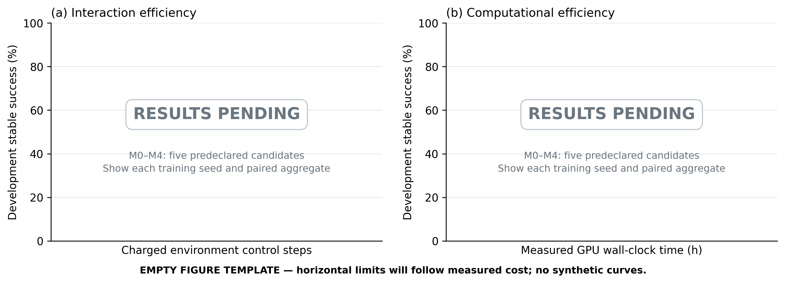

## Abstract

A bicycle robot may execute a nominal jump successfully yet fail to recover from a small deviation near take-off or landing. Improving such a policy requires finding states that expose its weaknesses, obtaining feasible recovery actions, and transferring those actions into an independently executable controller. We present JIT, an iterative framework that connects learned exploration, a conditional diffusion recovery teacher, and policy learning through measured student progress. The explorer applies bounded control perturbations to a frozen jump policy. From the resulting states, the teacher generates short action sequences and verifies whether a sequence followed by the frozen policy completes the task. Verified trajectories supervise a student trained with proximal policy optimization and a reference-policy retention loss. Independent student outcomes subsequently update exploration, while successful student trajectories replenish the generative model. The method separates teacher-assisted recoverability from capability acquired by the deployed policy. Development experiments establish local recovery witnesses: the teacher succeeds consistently in 12 of 24 queries at student-visited states where the source policy fails. However, adding selected guidance leaves behavioral-cloning absorption at four of eight training roots, and a paired 32,000-transition PPO study yields one of eight stable successes in both arms. These findings identify teacher-to-student conversion as the outstanding empirical requirement. The results motivate evaluating recovery generation and independent policy acquisition separately in matched-budget, multi-seed comparisons.

**Keywords:** bicycle robot; dynamic recovery; reinforcement learning; diffusion model; active exploration; policy retention.

# 1. Introduction

Bicycle robots combine a narrow support region with coupled steering, propulsion, and body motion. Jumping adds a sequence of changing contact conditions: the robot must accelerate, create vertical motion, traverse flight, establish wheel contact, and recover forward balance. A learned controller can coordinate this sequence from familiar initial states. Its behavior after a perturbation is a different question. A small change before contact may lead to states that the nominal policy rarely visits, where its action predictions have received little useful supervision.

Recent work has expanded the motion repertoire of bicycle robots. Hierarchical residual reinforcement learning has been applied to path tracking [1], while Bicycle Acrobatics and LineRides demonstrate learned dynamic skills and spatially guided stunt control [2,3]. These advances motivate a complementary problem: given an existing jump policy, how can additional experience increase the set of conditions that the *same final policy* can handle? The objective is not simply to discover a successful trajectory. A recovery discovered with a search procedure becomes useful for deployment only when the controller can reproduce the behavior through its own observations and retain previously successful behavior.

Three difficulties arise when learning from failure. First, indiscriminate perturbations can concentrate experience on repetitive failures or states for which the available teacher cannot find a solution. Second, failure of the current policy does not imply that recovery is physically impossible. A short alternative action sequence may return the robot to states from which the current policy can complete the jump. Third, success under this temporary intervention does not establish that a trained student has acquired the recovery. Errors on the student's own state distribution can accumulate near contact even when its regression error on demonstrations decreases.

JIT addresses these difficulties by coupling state discovery to verified teaching and subsequent student evaluation. A learned explorer perturbs a frozen jump policy through a bounded action interface. A conditional diffusion model proposes a short recovery sequence from a visited state. Each proposal is executed in simulation and handed back to the frozen policy without resetting the observation history or task state. A successful, repeatedly verified completion provides a teaching trajectory. The student combines these trajectories with on-policy task experience and action anchors from the original policy. The next exploration update receives credit for improvements achieved by the independent student, rather than for teacher success alone.

This separation determines the role of each component. Exploration selects where to seek supervision. Generation proposes alternative behavior at those states. Simulation tests whether the proposed behavior leads to task completion. Student optimization determines whether that behavior can be represented and executed by the final policy. The diffusion model remains a training-time teacher, so deployment requires only the jump Actor and its fixed observation preprocessing.

The contributions of this work are the following.

1. We formulate recovery-oriented policy improvement as an alternating exploration–teaching–learning process with two explicit feedback paths: student improvement to exploration, and successful student trajectories to the generative teacher.
2. We specify a short-horizon generative teaching procedure with a frozen-policy continuation, identical starting context, fixed-winner verification, and supervision from actual executed trajectories.
3. We combine task learning with reference-policy retention and define an evaluation that separately measures recovery witnesses, student absorption, new successes, and lost successes.

The current experiments establish that the teacher can supply recovery behavior unavailable to the source policy at selected visited states. They also show that this behavior has not yet translated into a repeatable advantage of the PPO student. The experiments therefore distinguish local recovery witnesses, independent absorption, and retention, and define a matched-budget comparison for evaluating the complete learning loop.

# 2. Related work

## 2.1. Bicycle control and learned dynamic skills

Model-based control and reinforcement learning address different sources of difficulty in bicycle motion. Huo et al. combine a nominal hierarchy with learned residual control for path tracking [1]. Their formulation concerns continuous tracking and motivates the use of established behavior as a foundation for learning. JIT instead starts from a learned jumping policy and asks how training-time interventions can expand its recovery capability. The exploration perturbation is removed at deployment; it is not a second controller that remains active alongside the final policy.

Bicycle Acrobatics [2] and LineRides [3] demonstrate the breadth of dynamic behaviors available to learned bicycle controllers. In particular, LineRides uses spatial guidance to organize stunt learning. JIT addresses the supply of useful recovery experience after a policy already exists. Its teaching target is an action trajectory verified from a physically visited context. The relevant comparison is therefore the capability of the final student under matched evaluation conditions, rather than the variety of trajectories found by an ensemble of controllers.

## 2.2. Exploration and curriculum construction

Returning to previously visited states can make difficult exploration more tractable, as illustrated by Go-Explore [4]. Reverse curriculum generation organizes training around a gradually changing distribution of starting states [5]. These methods motivate separating state acquisition from policy optimization. JIT uses the current source policy's visitation history and local outcome evidence to guide short perturbations. Its feedback additionally distinguishes a state that a teacher solves from a state that a successor student learns to solve.

Residual reinforcement learning combines a prior controller with learned corrections [6]. The action composition in JIT's exploration stage has a related form, but its purpose and lifetime differ. The explorer is a training-side acquisition policy. Its reward is tied to sampled novelty, direct failures, and delayed student outcomes. Bounded corrections define the intervention space; they do not establish stability or guarantee recoverability.

## 2.3. Generative action models and closed-loop imitation

Denoising diffusion models learn a data distribution through noise prediction [7], and DDIM provides a reduced-step sampling procedure [8]. Diffusion Policy applies conditional diffusion to robot action sequences [9]. JIT uses this sequence model to propose a finite recovery prefix. The prefix is followed by the frozen jump policy, and the whole completion is evaluated. This differs from deploying a diffusion controller with repeated receding-horizon inference.

Distribution shift between expert trajectories and learner-induced states is a central issue in imitation learning. DAgger addresses this issue through iterative data aggregation and expert queries on learner states [10]. JIT's student-visited-state diagnostic draws on this motivation, but the teacher is a finite generative search that may fail to find a valid recovery. It is not assumed to be an always-available optimal expert. Reference-policy action anchors further constrain the student on previously successful training trajectories, while explicit paired evaluation measures whether the constraint preserves closed-loop performance.

# 3. Problem formulation

## 3.1. Hybrid control state and policy interface

Let $\chi_t$ denote the complete simulation and control context at control step $t$. It includes generalized position $q_t$, velocity $v_t$, observation history $h_t$, the previous action, task-phase and contact-event variables $e_t$, and the task clock. Random-generator state is retained when a context is stored for subsequent training or evaluation. The control process is

$$
\chi_{t+1}=F_{\Delta t}(\chi_t,u_t),\qquad
o_t=O(\chi_t),\qquad p_t=P(\chi_t),\qquad u_t=\mathcal M(a_t).
\tag{1}
$$

Here $o_t\in\mathbb R^{76}$ is the Actor observation, $p_t\in\mathbb R^{106}$ is the privileged training observation, and $a_t\in[-1,1]^4$ is a normalized action. The mapping $\mathcal M$ converts the action into steering position, rear-wheel velocity, hip position, and knee position targets, in that order. A control step lasts $\Delta t=0.020$ s and comprises four 0.005 s physics steps. Contact dynamics are represented by the simulator in $F_{\Delta t}$; JIT does not require a differentiable analytical contact model.

The Actor uses three consecutive 25-dimensional observation frames and one jump indicator,

$$
o_t=[f_{t-2}^{\mathsf T},f_{t-1}^{\mathsf T},f_t^{\mathsf T},b_t]^{\mathsf T}.
\tag{2}
$$

Each frame contains body-frame gravity, angular velocity and acceleration; three joint positions and velocities; two wheel velocities; the preceding four-dimensional action; forward velocity, obstacle-relative position, root height, and a history-valid flag. Missing early frames are masked through the flag. The forward-velocity channel currently uses simulated root velocity, so a physical implementation would require a compatible estimator.

Let $N_A$ and $N_V$ be the fixed Actor and Critic normalizers, with $N_A(o)=(o-\mu_A)\oslash\sigma_A$ and the analogous elementwise rule for $N_V$. Stored standard deviations are used directly, without additional inference-time clipping. For Actor parameters $\theta$ and Critic parameters $\nu$, the stochastic training policy and deterministic execution rule are

$$
z_t^\pi\sim\mathcal N\!\left(\mu_\theta(N_A(o_t)),
\operatorname{diag}\sigma_\theta^2(N_A(o_t))\right),\qquad
a_t^\pi=\tanh z_t^\pi,\qquad
\bar\pi_\theta(o)=\tanh\mu_\theta(N_A(o)).
\tag{3}
$$

The Critic is $V_\nu(N_V(p_t))$. Both normalizers remain frozen in the retention formulation evaluated here, whereas $\theta$ and $\nu$ are trainable. A model identity therefore comprises the Actor, its preprocessing, the action mapping, and the observation ordering, not only a weight file.

## 3.2. Recovery objective and success event

The original policy $\pi_0$ provides the initial skill and the retention reference. For a distribution $\mathcal D$ over complete starting conditions and declared perturbations, define

$$
J_{\mathcal D}(\pi)=
\mathbb E_{\xi\sim\mathcal D}\!\left[S(\pi;\xi)\right],\qquad
\max_\theta J_{\mathcal D_{\mathrm{recovery}}}(\pi_\theta)
\quad\text{subject to}\quad
J_{\mathcal D_b}(\pi_\theta)-J_{\mathcal D_b}(\pi_0)\ge-\delta_b.
\tag{4}
$$

$S$ is binary task success. The retention distributions $\mathcal D_b$ represent declared old-task conditions, and $\delta_b$ is an allowed non-inferiority margin. Equation (4) defines the evaluation objective. The retention penalty introduced below is a practical surrogate, not a certificate that these constraints hold.

Success requires a jump followed by sustained recovery. After the robot has become airborne, valid contact requires a wheel to contact the ground without excessive penetration or body contact. Let $c_t$ indicate that valid contact has already occurred, and let $\sigma_t$ indicate that the current sample is finite, free of body contact and backward exit, and satisfies

$$
v_t^x\ge0.5\ \mathrm{m\,s^{-1}},\quad
|\varphi_t|\le10^\circ,\quad |\vartheta_t|\le15^\circ,\quad
d_t^{f},d_t^{r}\le0.02\ {\mathrm{m}},\quad
d_t^{\mathrm{penetration}}\le0.01\ {\mathrm{m}}.
\tag{5}
$$

The consecutive stable-sample counter is

$$
\begin{aligned}
n_t&=
\begin{cases}
n_{t-1}+1,&c_{t-1}=1\ \text{and}\ \sigma_t=1,\\
0,&\text{otherwise},
\end{cases}\\
S=1&\ \Longleftrightarrow\
n_t\ge25,\quad x_t-x_{\mathrm{contact}}\ge-10^{-6}\ \mathrm{m}.
\end{aligned}
\tag{6}
$$

Success additionally requires that no physical failure or timeout occurs at the endpoint. The first contact sample is time zero for this counter, so the 25 following control samples represent 0.5 s. Airborne detection uses both wheel clearances exceeding 0.05 m. Physical termination limits are distinct from the tighter recovery thresholds in (5). The full reward and event definitions are given in Appendix A.

## 3.3. Assisted recovery and independent capability

A recovery teacher supplies a temporary intervention, whereas the student must execute without it. For a starting context $\chi$, define source and teacher outcomes as

$$
y^0(\chi)=S(\bar\pi_k;\chi),\qquad
y^T(\chi,U)=S(T(\bar\pi_k,U);\chi).
\tag{7}
$$

$T$ applies a proposed action sequence $U$ and then returns control to $\bar\pi_k$. A case with $y^0=0$ and $y^T=1$ is a recovery witness relative to that source policy and the declared verification protocol. A student has absorbed the recovery only when $S(\bar\pi_{k+1};\chi)=1$ independently.

This distinction prevents successful search from being counted as policy improvement. It also separates local recoverability from complete-task performance: a student can succeed when initialized at a stored recovery context yet fail to reach or handle that context during a full jump.

# 4. JIT: exploration, generative teaching, and student learning

## 4.1. Alternating learning architecture

Figure 1 depicts the complete framework. At iteration $k$, JIT freezes $\pi_k$ for exploration and teacher continuation. The explorer $E_{\phi_k}$ generates physically visited contexts. The teacher $G_{\psi_k}$ proposes recovery actions and converts verified completions into demonstrations. Student optimization produces a candidate $\pi_{k+1}$. Independent evaluations of that candidate then provide exploration credit and successful trajectories for updating the teacher.

![Figure 1. The supplied JIT framework, reproduced without modifying its content. Solid arrows denote execution and data flow; dashed arrows denote parameter updates or training feedback. The source jump policy is frozen during collection and teacher evaluation. Only the student Actor is required at deployment. Skill expansion and robust generalization are the objectives of the framework. The experiments in this draft concern control perturbations; the external-disturbance branch remains to be evaluated.](generative_bridge_assets/framework.png)

The three networks are updated in separate stages. Gradients do not pass through the simulator or from the student's loss through the diffusion sampler into the explorer. This makes the learning signal depend on observable outcomes at shared contexts, while allowing each component to use an appropriate optimization objective.

## 4.2. Exploration informed by local experience

A useful perturbation should reveal behavior outside the source policy's familiar visits while remaining informative for subsequent learning. The explorer receives the privileged observation and a local summary of historical outcomes. For up to $K_N=16$ neighboring entries, let $r_j\in\mathbb R^{12}$ be relative physical coordinates, $\ell_j\in\{0,1\}^4$ contain outcome indicators, and $m_j$ mark a valid entry. The four indicators distinguish current-source success, current-source failure, historical policy success, and verified teacher success. Unknown or conflicting records are not encoded as confident failure.

Each exploration head has its own entry encoder $g_\phi$ (16–64–64 with ELU), which produces a 64-dimensional feature. The validity mask is applied before and after encoding, rather than being an encoder input. The pooled feature is

$$
h_N=\frac{\sum_{j=1}^{K_N}m_jg_\phi(\operatorname{where}(m_j,[r_j,\ell_j],0))}
{\max(1,\sum_{j=1}^{K_N}m_j)},\qquad
x_t=[N_E(p_t),h_N,s_N],
\tag{8}
$$

where $s_N\in\mathbb R^8$ contains neighborhood summary statistics. The fixed preprocessing $N_E$ normalizes only the privileged base channels. The raw interface has $106+16(17)+8=386$ dimensions; the pooled head receives $106+64+8=178$. The neighborhood is frozen before the collection stage, so it cannot contain outcomes from a student that has not yet been trained.

The exploration Actor samples a latent Gaussian and transforms it into a bounded action request,

$$
z_t^E\sim\mathcal N(\mu_\phi(x_t),\operatorname{diag}\sigma_\phi^2(x_t)),
\qquad \delta_t=\rho\tanh z_t^E,\qquad \rho=0.25.
\tag{9}
$$

For one three-step window starting at $\tau\in\{0,5,10,15\}$,

$$
m_t^{\mathrm{pulse}}=\mathbf1\{\tau\le t<\tau+3\},\qquad
a_t=\operatorname{clip}\!\left(\bar\pi_k(o_t)+m_t^{\mathrm{pulse}}\delta_t,-1,1\right),
\qquad
\delta_t^{\mathrm{eff}}=a_t-\bar\pi_k(o_t).
\tag{10}
$$

The effective perturbation can be smaller than the request because the summed action is clipped. Both quantities are recorded. Outside this window, the source policy acts alone. The perturbation changes control commands and generates a trajectory through the original dynamics, without injecting an arbitrary physical state.

Exploration novelty is measured against the frozen source policy's own visitation ledger. Let $\mathcal C_i$ be the physical cells visited during episode $i$'s executed intervention, $\mathcal S_k$ the cells already recorded for the source policy, and $n(c)$ the number of current-batch episodes visiting a new cell. The novelty term is

$$
r_i^{\mathrm{nov}}=
\begin{cases}
\dfrac{\beta_N}{|\mathcal C_i|}
\displaystyle\sum_{c\in\mathcal C_i\setminus\mathcal S_k}\dfrac{1}{n(c)},
&\mathcal C_i\setminus\mathcal S_k\ne\varnothing,\\
-\beta_N,&\mathcal C_i\subseteq\mathcal S_k,
\end{cases}
\qquad \beta_N=0.02.
\tag{11}
$$

Duplicate discoveries share credit. This is a statistic of sampled visitation under a fixed discretization, not an estimate of continuous controllable volume. An episode without an eligible executed intervention is excluded from the exploration update.

The delayed quality reward uses independent student outcomes at the same training root. With $y_i^{\mathrm{pre}}$ and $y_i^{\mathrm{post}}$ denoting valid pre- and post-training binary labels, and $a_i^{\mathrm{accept}}$ indicating that the successor is permitted to continue, define $q_i=a_i^{\mathrm{accept}}\mathbf1\{y_i^{\mathrm{source\ recheck}}\ne1\}$. The quality reward is

$$
r_i^{\mathrm{learn}}=
2\,\mathbf1\{y_i^{\mathrm{pre}}=0,y_i^{\mathrm{post}}=1,q_i=1\}
-0.1\,\mathbf1\{y_i^{\mathrm{pre}}=0,y_i^{\mathrm{post}}=0\}.
\tag{12}
$$

Direct physical failure during the intervention overrides the episode reward:

$$
R_i^E=
\begin{cases}
-2,&\text{direct physical failure during exploration},\\
r_i^{\mathrm{nov}}+r_i^{\mathrm{learn}},&\text{otherwise}.
\end{cases}
\tag{13}
$$

Eligibility masks retain only valid, attributable outcomes. Source-policy success found during verification cancels incremental-learning credit. Teacher success itself carries no positive quality bonus.

The explorer is optimized using PPO [11] on the current collection's stored latent actions and behavior probabilities. If $\varrho_{it}^E=p_\phi(z_{it}^E|x_{it})/p_{\phi_{\mathrm{old}}}(z_{it}^E|x_{it})$, then its policy objective is

$$
L_E^{\mathrm{clip}}
=-\mathbb E_{\mathrm{valid}}\!\left[
\min\left(\varrho_{it}^E A_{it}^E,
\operatorname{clip}(\varrho_{it}^E,1-\epsilon_E,1+\epsilon_E)A_{it}^E\right)
\right],\qquad \epsilon_E=0.2.
\tag{14}
$$

A clipped value loss and latent-Gaussian entropy term complete the objective, as specified in Appendix B.3. Delayed terminal credit is propagated over executed perturbation actions with $\gamma_E=\lambda_E=1$. The implemented update uses up to four epochs. A target KL of 0.01 adapts the learning rate; a separate post-epoch threshold of 0.03 stops additional epochs. Historical root records are neighborhood evidence, not replayed on-policy PPO transitions.

## 4.3. Conditional diffusion as a short recovery teacher

A short intervention can change the state at which the existing policy resumes. JIT models these interventions as normalized absolute action sequences $U\in[-1,1]^{H\times4}$, with $H=16$ control steps. The sequence therefore spans 0.32 s. Conditioning uses the root Actor observation normalized by the generator's fixed source statistics, $c=N_G(o)$.

For a noise level $n$, the forward diffusion process is

$$
q(X_n|U)=
\mathcal N\!\left(\sqrt{\bar\alpha_n}U,(1-\bar\alpha_n)I\right),
\qquad
X_n=\sqrt{\bar\alpha_n}U+\sqrt{1-\bar\alpha_n}\,\varepsilon,
\quad\varepsilon\sim\mathcal N(0,I).
\tag{15}
$$

The conditional noise predictor $\varepsilon_\psi(X_n,n,c)$ is a one-dimensional U-Net operating along the action-sequence axis, with channels 64, 128, and 256, residual blocks, GroupNorm, and FiLM conditioning. Its denoising loss is

$$
L_G(\psi)=
\mathbb E_{(o,U),\,n,\,\varepsilon}
\left[\frac{1}{4H}
\left\|\varepsilon-\varepsilon_\psi(X_n,n,N_G(o))\right\|_F^2\right].
\tag{16}
$$

The data are executed action windows from successful simulated training trajectories. A window cannot cross a reset or be padded into a successful example. The diffusion noise index and physical control time are distinct variables.

The implemented generator uses a 100-level cosine schedule and 20-step deterministic DDIM sampling [8]. For a selected noise index $n$ and the next cumulative signal coefficient $a_{\mathrm{next}}$, the update clips the clean estimate and recomputes its residual noise:

$$
\begin{aligned}
\widehat U&=\operatorname{clip}\!\left(
\frac{X_n-\sqrt{1-\bar\alpha_n}\,\varepsilon_{\bar\psi}(X_n,n,c)}
{\sqrt{\bar\alpha_n}},-1,1\right),\\
\widetilde\varepsilon_n&=\frac{X_n-\sqrt{\bar\alpha_n}\widehat U}
{\sqrt{1-\bar\alpha_n}},\\
X_{\mathrm{next}}&=\sqrt{a_{\mathrm{next}}}\widehat U+
\sqrt{1-a_{\mathrm{next}}}\,\widetilde\varepsilon_n.
\end{aligned}
\tag{17}
$$

The selected indices are $99,94,\ldots,4$. For $n\ge5$, $a_{\mathrm{next}}=\bar\alpha_{n-5}$; the final update uses $a_{\mathrm{next}}=1$ and returns $\widehat U$. Appendix B.4 gives the schedule.

Sampling starts from an independent Gaussian sequence for each candidate. $\bar\psi$ denotes exponential-moving-average parameters,

$$
\bar\psi\leftarrow0.999\bar\psi+0.001\psi.
\tag{18}
$$

Denoising accuracy measures the learned sequence model. Physical evaluation determines whether any generated sequence is a useful recovery.

## 4.4. Verification and construction of teaching trajectories

For each query context $\chi_i$, the teacher proposes $C=16$ action sequences. A source-only continuation is evaluated alongside them. During candidate $c$'s trajectory, the executed action is

$$
a_{t_i+\ell}^{T,c}=
\begin{cases}
\operatorname{clip}(U_\ell^{(c)},-1,1),&0\le\ell<H,\\
\bar\pi_k(o_{t_i+\ell}),&\ell\ge H.
\end{cases}
\tag{19}
$$

The prefix uses absolute actions rather than residuals added to the source policy. The generator is conditioned once at the root; it does not replan at each step. The handover at $H$ preserves the current physical state, observation history, previous action, event variables, and task time.

All candidates begin from the same stored context. Among candidates satisfying the complete task endpoint, the winner minimizes full-trajectory action variation, then maximizes task return, with candidate index as a final tie-breaker:

$$
c_i^*=\mathop{\operatorname{lex\,argmin}}_{c:S(T_c;\chi_i)=1}
\left(
\sum_{\ell=0}^{T_i^c-1}\|a_{t_i+\ell}^{T,c}-a_{t_i+\ell-1}^{T,c}\|_2^2,
-\sum_{\ell=0}^{T_i^c-1}r_{t_i+\ell}^{c},c
\right).
\tag{20}
$$

The first action difference uses the root's actual preceding action. Selection includes the continuation after the generated prefix. If no candidate succeeds, the query has no witness under this finite search budget.

The winning sequence is fixed before two additional evaluations with the same candidate layout. Let $y_{ir}^0$, $y_{ir}^{\mathrm{src}}$, and $y_{ir}^{T}$ denote an independent source continuation, the source-only comparison lane, and the fixed teacher winner for repeat $r\in\{1,2,3\}$. For the original-root teacher screen, incremental teaching admission requires

$$
w_i=
\prod_{r=1}^{3}
(1-y_{ir}^0)(1-y_{ir}^{\mathrm{src}})y_{ir}^{T}=1,
\qquad\text{with all evaluations complete and valid}.
\tag{21}
$$

A failed verification does not trigger replacement of the winner by a different candidate. Conflicting repeats remain ambiguous. This requirement tests the reproducibility of a specific recovery sequence rather than searching repeatedly until some attempt happens to pass.

Equation (21) describes the original-root screen. At a newly captured student-visited context, the executed diagnostic uses the same-layout source and teacher triple only; its witness predicate is $\prod_{r=1}^{3}(1-y_{ir}^{\mathrm{src}})y_{ir}^{T}=1$. It does not add a separate independent source triple. Admission of such a trajectory additionally requires an eligible historically stable-failure ancestor and failure of the querying student. The formal outer-loop protocol retains the original-root verification rule.

The demonstration set stores actual observations immediately before execution and the corresponding executed actions,

$$
\mathcal D_T=\{(o_{i\ell}^{T},a_{i\ell}^{T},i,\ell):w_i=1\}.
\tag{22}
$$

Both the generative prefix and successful source-policy tail are included. For supervised sampling, ancestors receive equal mass, trajectories within an ancestor receive equal mass, and prefix and tail each receive one half of a trajectory's mass. Thus a longer tail does not dominate training merely by containing more frames.

Student-visited contexts provide a direct test of distribution mismatch. From each declared training root, the student is advanced for $j\in\{4,8,12\}$ steps, and its actual context is queried. The remaining intervention length is

$$
H_j=H-j.
\tag{23}
$$

The generator still outputs 16 actions, but only the first $H_j$ are executed. The total handover time relative to the original root remains $H$. Querying every declared ancestor before applying admission rules avoids selecting only visually promising trajectories.

## 4.5. Learning an independent student while anchoring prior behavior

The student must learn to complete the task from complete starts as well as from recovery contexts. The retention formulation uses four reset pools with equal probability,

$$
\mathcal D_{\mathrm{reset}}
=\tfrac14\mathcal D_{\mathrm{nominal}}
+\tfrac14\mathcal D_{\mathrm{random}}
+\tfrac14\mathcal D_{\pi_0{\mathrm{-success}}}
+\tfrac14\mathcal D_{\mathrm{teacher-recoverable}}.
\tag{24}
$$

The same rule applies to initial resets and resets after termination. Snapshot pools retain the declared history, event variables, and task clock. They supply training support; endpoint evaluation additionally uses complete initial conditions.

PPO [11] supplies a task-directed learning signal. Let $r_t^\prime$ be the preprocessed and scaled learner reward, $d_t$ the non-truncation termination indicator, and $b_t=1-\tau_t$ the mask for truncation flag $\tau_t$. Then the value residual and generalized advantage recursion [12] can be written as

$$
\delta_t=b_t\!\left[r_t^\prime+\gamma(1-d_t)V_\nu(p_{t+1})-V_\nu(p_t)\right],
\qquad
A_t^{\mathrm{GAE}}=\delta_t+
b_t\gamma\lambda(1-d_t)A_{t+1}^{\mathrm{GAE}}.
\tag{25}
$$

Normalizer application is suppressed in the value notation. The termination mask is $d_t=(1-\mathrm{discount}_t)(1-\tau_t)$. Values are recomputed with the current Critic parameters inside each loss call. The implementation masks truncations separately from physical termination. Appendix B gives the exact value-target and policy-advantage convention used by the learner.

For a collected action and its fixed behavior policy, the likelihood ratio is

$$
\varrho_t(\theta)=
\frac{\pi_\theta(a_t|o_t)}{\pi_{\theta_{\mathrm{old}}}(a_t|o_t)}.
\tag{26}
$$

Using a normalized, stopped-gradient policy advantage $\widehat A_t$, the clipped policy term is

$$
L_\pi=
-\mathbb E_t\!\left[
\min\left(\varrho_t\widehat A_t,
\operatorname{clip}(\varrho_t,1-\epsilon,1+\epsilon)\widehat A_t\right)
\right].
\tag{27}
$$

The task objective includes value regression and policy entropy,

$$
L_{\mathrm{PPO}}=L_\pi+c_V\mathbb E_t[(V_\nu(p_t)-\widehat V_t)^2]
-c_H\mathbb E_t[\mathcal H(\pi_\theta(\cdot|o_t))].
\tag{28}
$$

Verified teaching trajectories provide a supervised objective on the deterministic student action,

$$
L_{\mathrm{demo}}=
\mathbb E_{(o,a^T)\sim\mathcal D_T}
\left[\frac14\|\bar\pi_\theta(o)-a^T\|_2^2\right].
\tag{29}
$$

The retention corpus $\mathcal D_K$ consists of observations from successful original-policy training trajectories. A frozen original policy supplies the targets,

$$
L_{\mathrm{keep}}=
\mathbb E_{o\sim\mathcal D_K}
\left[\frac14\|\bar\pi_\theta(o)-
\operatorname{sg}[\bar\pi_0(o)]\|_2^2\right],
\tag{30}
$$

where $\operatorname{sg}$ stops gradients. The two losses act on their respective state distributions. The teacher and original policy are not averaged into a single target at a recovery state.

The combined optimization problem is

$$
L_S(\theta,\nu;u)=
L_{\mathrm{PPO}}+\lambda_D(u)L_{\mathrm{demo}}+\lambda_K L_{\mathrm{keep}},
\qquad \lambda_K=0.2,
\tag{31}
$$

with an interaction-based demonstration schedule,

$$
\lambda_D(u)=0.2-0.15\min\!\left(\frac{u}{128000},1\right).
\tag{32}
$$

Here $u$ counts newly collected student transitions within the declared learning stage, independently of normalizer counts and optimizer steps. A 32,000-transition pilot therefore ends at $\lambda_D=0.1625$; it does not compress the schedule to reach 0.05.

Both Actor and Critic are initialized from $\pi_0$ in the paired pilot, with fresh Adam state. The Critic remains trainable while all normalizer statistics are fixed. A full outer-loop run subsequently inherits the complete learner state between stages. Simulator episodes are reset from the declared support, so learner-state continuation does not imply continuous recovery of the previous simulation trajectory.

Action matching alone is insufficient to establish retention. Equation (30) constrains a finite set of observations, whereas future observations depend on the updated controller. This is why JIT evaluates old-success losses and new-success gains directly, even when both supervised losses decrease.

## 4.6. Feedback to exploration and generation

The successor policy closes the loop in two ways. First, its independent outcomes determine the delayed reward in (12). This rewards recovery learned by the student rather than recovery performed by the teacher. Second, successful student trajectories become candidate training windows for the generator. Only trajectories from a student accepted for experimental continuation enter this feedback corpus. The requested mixture is

$$
\mathcal D_G=
0.50\,\mathcal D_{\mathrm{history}}
+0.25\,\mathcal D_{\mathrm{verified\ teacher}}
+0.25\,\mathcal D_{\mathrm{successful\ student}}.
\tag{33}
$$

When a source is empty, the remaining nonempty sources are renormalized. Within a source, sampling balances ancestor, trajectory, and valid action window. Only eligible training ancestors contribute. Student failure trajectories, development evaluation data, and final test data are excluded.

The generator receives up to 2,000 denoising updates per outer iteration. A valid completed state and its EMA parameters are retained; generator-development denoising error is a model diagnostic, not a physical recovery score. The full feedback ablation removes both the student-quality term in exploration and successful-student data in (33), while retaining novelty, direct failure penalties, and the student learning rule.

**Algorithm 1. Alternating recovery learning in JIT.**

1. Initialize the source policy, frozen observation statistics, pretrained generator, explorer, and training-only data stores.
2. Freeze the current source policy and neighborhood evidence. Collect declared perturbation episodes with $E_\phi$ and store complete visited contexts.
3. Select the query roots before teacher search. Generate the fixed number of candidates, execute each prefix and source-policy continuation, select a winner, and verify that winner without reselection.
4. Construct the teaching set from qualified trajectories. Train the student with (31) on fresh on-policy transitions and the fixed auxiliary sampling rules.
5. Evaluate the independent student at the same training roots and at the declared development conditions. Retain complete success, failure, and ambiguous labels.
6. If the stage satisfies its continuation conditions, compute exploration credit from the student outcomes and update $E_\phi$ using the original collection's behavior probabilities.
7. Add eligible teacher and student successes to the generator corpus, update $G_\psi$, and begin the next iteration with the accepted student. Stop at the declared iteration or resource limit, or at a failed continuation condition.

At deployment, Steps 2–7 are absent. The controller executes $\bar\pi_\theta(o_t)$ with the same observation history, normalization, action order, and target mapping.

# 5. Experimental design

## 5.1. Research questions and comparison methods

The evaluation is organized around four questions. Does the teacher provide repeatable recoveries from contexts that defeat the source policy? Does the student acquire those recoveries independently? Does the complete loop improve task performance without exceeding the declared retention margin? Which gains depend on learned exploration, generative teaching, and student feedback?

Table 1 defines the formal comparison. The two-arm pilot in Section 6 isolates student learning with a fixed teacher corpus. It does not instantiate all five methods.

**Table 1. Formal comparison methods. The final column states the contrast supported by each control. Results are pending.**

| Method | Exploration | Teacher | Explicit student feedback | Intended comparison |
|:---|:---|:---|:---|:---|
| M0: PPO + keep | None | None | None | Overall benefit of JIT |
| M1: Full JIT | Learned | 16 diffusion candidates | Both paths | Complete method |
| M2: Random exploration | Fixed random | 16 diffusion candidates | Student to generator | Contribution of learned exploration |
| M3: Noise teacher | Learned | 16 colored-noise candidates | Student quality to explorer | Contribution of generative teaching |
| M4: No explicit feedback | Learned | 16 diffusion candidates | Both paths removed | Joint contribution of the feedback paths |

Random exploration in M2 has no learned explorer update, and the noise teacher in M3 has no generator update. Each keeps the feedback path applicable to its remaining learned module. M4 retains novelty, direct physical-failure penalties, teacher verification, and the student update. Its result can identify a joint feedback contribution, but cannot isolate the two feedback arrows separately. M3 does not perform unused generator optimization to artificially equalize computation.

Three paired outer-loop training seeds are specified: 1011501, 1011502, and 1011503. All methods start from the same $\pi_0$. Methods using a generator also share the same pretrained generator and EMA initialization; their subsequent data and parameter updates are independent. The experiment therefore repeats outer-loop training under common pretrained initialization, rather than training the complete system from scratch three times.

Each complete-method run has at most five outer iterations. An iteration collects 128 exploration episodes, selects up to 16 roots before teacher search, evaluates 16 candidates and one source continuation per root, and trains the student for 128,000 transitions. Explorer and generator update limits are four epochs and 2,000 gradient steps, respectively. These are specifications for the formal experiment; the resulting success rates have not been measured.

## 5.2. Data partitions and repeated outcomes

TRAIN data support exploration, teacher fitting, demonstration construction, and student updates. SOLVER_DEV contains held-out recovery roots used for development. DEV contains complete-task conditions used for model selection and retention monitoring. A separate final TEST is opened only after the methods, model-selection rule, and checkpoints are frozen. Descendant observations retain their ancestor's partition.

For each condition $i$ with complete valid observations, three fixed evaluations produce labels $y_{i1},y_{i2},y_{i3}$. We define stable success, stable failure, and ambiguity as

$$
s_i(\pi)=\prod_{r=1}^{3}y_{ir},\qquad
f_i(\pi)=\prod_{r=1}^{3}(1-y_{ir}),\qquad
a_i(\pi)=1-s_i(\pi)-f_i(\pi).
\tag{34}
$$

Stable success requires all three evaluations to succeed. Ambiguity is retained as an outcome category. Three evaluations of one trained model are numerical repetitions, not independent training seeds.

For a condition group $\mathcal I_b$, the stable success rate is

$$
\widehat p_b(\pi)=\frac{1}{|\mathcal I_b|}
\sum_{i\in\mathcal I_b}s_i(\pi).
\tag{35}
$$

When comparing a student with $\pi_0$, the strict paired set contains only conditions with unambiguous labels for both:

$$
\mathcal P=\{i:a_i(\pi_0)=a_i(\pi)=0\},\quad
G=\sum_{i\in\mathcal P}f_i(\pi_0)s_i(\pi),\quad
L=\sum_{i\in\mathcal P}s_i(\pi_0)f_i(\pi),\quad
\Delta=G-L.
\tag{36}
$$

The paired retention fraction is

$$
R_{\mathrm{keep}}=
\frac{\sum_{i\in\mathcal P}s_i(\pi_0)s_i(\pi)}
{\sum_{i\in\mathcal P}s_i(\pi_0)}.
\tag{37}
$$

It is undefined when the denominator is zero. Conditions leaving the paired set because of ambiguity are reported separately. In particular, $\Delta$ need not equal the difference in stable-success totals over the full set when the source has ambiguous labels.

## 5.3. Final evaluation and retention

The specified TEST contains 257 conditions: one nominal complete start, 64 unseen random initial states without a pulse, 64 nominal starts with control pulses, 64 random initial states with pulses, and 64 extrapolation conditions. The extrapolation group contains 32 larger requests with maximum absolute component sampled from $[0.30,0.35]$, and 32 requests with onset in $\{2,7,12,17\}$. Pulse length, clipping, physics, and endpoint definitions remain unchanged. Requested and effective perturbations are both recorded.

The primary measure averages the three in-distribution random-condition groups, excluding the single nominal case and the extrapolation group:

$$
\widehat J_{\mathrm{macro}}(\pi)=
\frac13\left(\widehat p_B(\pi)+\widehat p_C(\pi)+\widehat p_D(\pi)\right).
\tag{38}
$$

For paired training seeds $s=1,\ldots,3$, the overall comparison is

$$
d_s=\widehat J_{\mathrm{macro}}(\pi_{{\mathrm{M1}},s})
-\widehat J_{\mathrm{macro}}(\pi_{{\mathrm{M0}},s}),\qquad
\bar d=\frac13\sum_{s=1}^{3}d_s.
\tag{39}
$$

The engineering target is $\bar d\ge0.05$ with the same direction in all three seeds. Uncertainty intervals and per-seed values accompany this target; a mean improvement alone does not establish a statistically resolved effect. Retention is assessed separately for groups B and D with a five-percentage-point margin,

$$
d_{b,s}^{\mathrm{ret}}=
\widehat p_b(\pi_{{\mathrm{M1}},s})-\widehat p_b(\pi_0),
\qquad
\text{non-inferiority requires the declared lower interval bound}>-0.05.
\tag{40}
$$

The inferential analysis must respect both training-seed and condition-ancestor dependence [13]. The proposed reporting procedure resamples paired seeds and condition ancestors, keeping all numerical repeats of an ancestor together, and reports 95% intervals together with every seed's result. The resampling specification will be frozen before formal training. With only three training seeds, the intervals should be interpreted alongside the individual effects. No result from TEST returns to training or model selection.

## 5.4. Resource matching

Different comparisons require different controls. M1–M4 hold outer-iteration count, candidate count, and student interaction budget fixed to isolate modules, while reporting their actual costs. M0 is instead matched to the physical cost of M1 for the corresponding seed. After reserving evaluation cost, M0 uses complete PPO batches within that budget and leaves any sub-batch remainder unused. Each arm has five predeclared model-selection candidates.

Physical cost counts all executed environment control steps, including failed candidates, verification, evaluation, and vectorized padding:

$$
B_{\mathrm{phys}}
=B_{\mathrm{explore}}+B_{\mathrm{teacher}}+B_{\mathrm{verify}}
+B_{\mathrm{student}}+B_{\mathrm{evaluate}}+B_{\mathrm{engineering}}.
\tag{41}
$$

Each term includes its associated active and padded steps. Generator and explorer optimizer updates and GPU wall time are reported separately. They are not added to physical steps as if these units were interchangeable. Historical generator pretraining and its data generation are listed independently; unrecovered historical costs remain unknown.

## 5.5. Transfer between simulation engines

The transfer experiment evaluates identical final Actor parameters and normalizers in the source and target engines. It covers three M1 students, three M0 students, and $\pi_0$, with 33 fixed conditions and three evaluations per condition in each engine. The conditions comprise one nominal start, eight random initial states, 16 nominal-start pulse conditions, and eight random-start pulse conditions. Target-engine learning is excluded from this comparison.

Before physical evaluation, saved 76-dimensional observations test inference equivalence:

$$
\epsilon_{\mathrm{export}}=
\max_{o\in\mathcal O_{\mathrm{check}}}
\|\bar\pi^{\mathrm{source}}(o)-\bar\pi^{\mathrm{exported}}(o)\|_\infty.
\tag{42}
$$

The interface must also preserve history order, action order and target semantics, control and physics periods, and velocity frames. In particular, root-origin and center-of-mass velocity obey

$$
v_{\mathrm{root}}=v_{\mathrm{COM}}-\omega\times r_{\mathrm{COM/root}},
\qquad
\omega_{\mathrm{body}}=R^{\mathsf T}\omega_{\mathrm{world}}.
\tag{43}
$$

All quantities in the first relation must be expressed in a common frame. The two engines use the same recovery criterion in (5)–(6). If target-engine adaptation is later required, it becomes a separate experiment with matched adaptation rules and a new model identity.

# 6. Development results and planned comparisons

## 6.1. Does generative teaching provide additional recovery behavior?

The teacher study screened 160 newly collected contexts and selected 16 TRAIN and seven SOLVER_DEV roots at which the original policy failed consistently. Diffusion and colored-noise teachers each evaluated 16 candidates with the same source-policy continuation and fixed-winner verification. Table 2 reports the complete paired outcome matrix.

**Table 2. Qualified recovery witnesses under matched candidate counts. A qualification requires the initially selected winner to pass both subsequent checks.**

| Partition | Diffusion only | Noise only | Both | Neither | Ambiguous pair | Total |
|:---|---:|---:|---:|---:|---:|---:|
| TRAIN | 3 | 5 | 5 | 2 | 1 | 16 |
| Solver dev. | 1 | 1 | 2 | 3 | 0 | 7 |

The diffusion teacher supplies eight qualified TRAIN trajectories and three SOLVER_DEV witnesses. The two teachers are complementary under this qualification rule. Their aggregate comparison does not establish higher recovery success for diffusion. In the ambiguous TRAIN pair, source labels change in the diffusion branch while the noise branch independently qualifies. Consequently, noise has 11 qualified TRAIN roots under its own rule, although only ten are included in the unambiguous paired cells of Table 2.

Qualification also differs from finding a successful action sequence at any time. One diffusion-only root has no successful noise winner in the initial search, but a noise candidate succeeds in a later evaluation. That observation remains in the underlying record; it does not satisfy the fixed-winner rule. The comparison therefore concerns repeatably qualified teaching trajectories, not physical impossibility for the alternative teacher.

A second study queries the teacher at states actually visited by a behavioral-cloning student. The eight training ancestors are each queried at three declared offsets, giving 24 queries. At 12 queries, the source-only branch fails in all three evaluations and the fixed generated prefix succeeds in all three. Four qualified queries from three historically stable-failure ancestors are admitted to the next supervised training set. These add 228 real observation–action pairs to the original 525.

## 6.2. Does supervision transfer to the independent student?

Figure 2 shows actual world-coordinate trajectories for every declared training root in the paired PPO study. The trajectories include failures and all fixed repeats, rather than only representative successful recoveries.

The supervised study compares two students trained for 1,000 behavioral-cloning updates from the same original policy, with the same 6,289 retention observations. One uses the original teacher data; the other adds selected student-visited guidance. Both achieve stable success at four of eight TRAIN roots. The added guidance changes which roots are solved: one previously stable failure becomes a stable success, while one previously stable success becomes a stable failure. A further root has labels $(1,0,0)$ and remains ambiguous.

On the first complete DEV evaluation, the student with added guidance succeeds in 56 of 64 cases, compared with 38 for the source policy, with 20 gains and two losses. That complete DEV comparison was not evaluated three times for this supervised stage. Its first-pass gain is therefore distinct from the stable labels reported for the subsequent PPO study.

The paired PPO experiment tests whether on-policy task learning converts the same guidance more effectively. Both arms begin with the original Actor and Critic, fresh Adam, frozen normalization, identical reset pools, and identical interaction budgets. The control minimizes PPO plus keep. The teaching arm additionally uses the fixed 753-frame demonstration set. Neither the explorer nor generator is updated. The final 32,000-transition checkpoint is evaluated in both arms, without selecting a better intermediate checkpoint.

**Table 3. Independent student results after 32,000 transitions per arm. Student TRAIN and all DEV results use three fixed evaluations. Student solver development results use one evaluation. The original-policy TRAIN and solver entries are inherited screening results, marked †.**

| Measure | Original policy | PPO + keep | PPO + demo + keep |
|:---|---:|---:|---:|
| Stable TRAIN success / 8 | 0† | 1 | 1 |
| Solver dev. first-pass success / 7 | 0† | 1 | 1 |
| DEV success in repeats 1 / 2 / 3 | 38 / 41 / 47 | 56 / 56 / 57 | 54 / 55 / 54 |
| Stable DEV success / 64 | 35 | 56 | 54 |
| Ambiguous DEV conditions / 64 | 14 | 1 | 1 |
| Strict paired new successes $G$ | Reference | 10 | 6 |
| Strict paired old-success losses $L$ | Reference | 3 | 0 |
| Strict paired net gain $\Delta$ | Reference | 7 | 6 |

† Original-policy TRAIN and solver roots were selected for stable failure in the earlier teacher screen; these two original-policy entries were not re-evaluated in the paired PPO pilot.

The teaching arm does not improve stable TRAIN absorption over the control. Its stable DEV success is two conditions lower, and its strict paired net gain is one condition lower. It loses none of the source policy's 35 stable successes in this finite development panel, whereas the control loses three. This retention observation accompanies a weaker gain count and is not a formal non-inferiority result. All stable original-policy successes remain unambiguous in both students. The 14 ambiguous source conditions also explain why the paired net gains differ from the changes in total stable success.

A predeclared continuation screen compared the teaching arm with the control. The teaching arm was required to solve at least five of eight TRAIN roots, exceed the control by at least one root, retain specified previously stable roots, achieve at least three of seven solver successes, and improve paired DEV net gain without worsening old losses. It does not meet these requirements. The formal five-method study has therefore not been used to amplify this pilot into a main-performance claim.

## 6.3. Why does lower action error not establish recovery learning?

Evaluation on saved observations separates action fitting from changes in visited state. On the teaching arm, mean squared error on the original demonstrations decreases from 0.009399 to 0.008583, and error on the added guidance decreases from 0.006506 to 0.005808. These improvements coexist with stable TRAIN absorption of only one of eight roots. The result is consistent with a gap between fitting actions on teacher observations and reproducing a successful closed-loop trajectory.

The recorded optimization also shows the relative scale of the learning signals. Across 80 actual updates, the weighted demonstration-gradient norm is a median 1.88% of the PPO Actor-gradient norm, ranging from 0.82% to 2.92%. The PPO and demonstration Actor gradients have negative cosine similarity in 37 updates. These measurements establish that the auxiliary supervision can be small and intermittently opposed to the task gradient. They do not identify a unique cause of failed absorption: clipping, Adam state, observation distribution, and contact dynamics jointly determine the parameter and trajectory changes.

An independent inference reconstruction checks the action execution chain on stored observations. For 7,291 shared observations across the demonstration, retention, and student-visited corpora, the model comparisons use the same raw input rather than actions at equal times on different trajectories. The maximum saved execution-chain discrepancy is below the tolerance calibrated from the original policy. Thus the available diagnosis does not indicate a gross mismatch in normalization or deterministic action reconstruction. Exact bitwise equivalence of contact trajectories is not implied.

## 6.4. Complete-method comparison and ablation panels

Table 4 and Figures 4–5 reserve the final comparison. Their unfilled entries are deliberate: these experiments have not been completed. Each row will summarize all three outer-loop training seeds, with per-seed values retained in the supplement.

**Table 4. Main TEST results template. Every PENDING entry requires a measured result after model freezing. Macro success follows (38); gains and losses follow (36).**

| Method | Macro stable success, % | Paired gain / loss | B retention difference, pp | D retention difference, pp | Physical steps / GPU h |
|:---|:---:|:---:|:---:|:---:|:---:|
| M0: PPO + keep | PENDING | PENDING | PENDING | PENDING | PENDING |
| M1: Full JIT | PENDING | PENDING | PENDING | PENDING | PENDING |
| M2: Random exploration | PENDING | PENDING | PENDING | PENDING | PENDING |
| M3: Noise teacher | PENDING | PENDING | PENDING | PENDING | PENDING |
| M4: No explicit feedback | PENDING | PENDING | PENDING | PENDING | PENDING |

The exploration contrast should report both the number of qualified teacher roots per query budget and the final student's performance. A novelty advantage without student improvement would establish changed sampling, not better skill acquisition. The generator contrast should likewise report qualification, absorbed recoveries, and computation, so that a better sequence model is not confused with a better policy.

**Table 5. Teacher-to-student conversion template for the formal study. Denominators are recorded per seed and iteration.**

| Quantity | M1 | M2 | M3 | M4 |
|:---|:---:|:---:|:---:|:---:|
| Roots queried before search | PENDING | PENDING | PENDING | PENDING |
| Qualified incremental teacher roots / queried | PENDING | PENDING | PENDING | PENDING |
| Independent stable student recoveries / qualified | PENDING | PENDING | PENDING | PENDING |
| Qualified roots remaining stable failures | PENDING | PENDING | PENDING | PENDING |
| Ambiguous teacher or student roots | PENDING | PENDING | PENDING | PENDING |

## 6.5. Same-model transfer

The available interface precheck evaluates exported inference on 525 saved TRAIN observations from the original policy. The maximum absolute action difference between source inference and the target-side Actor implementation is $4.77\times10^{-7}$. This verifies the tested inference interface without physical interaction.

The physical transfer comparison of the final M1 and M0 students is still pending. An earlier two-engine demonstration used a different policy lineage and included target-engine PPO training. It provides engineering background but cannot fill the zero-target-training comparison in Table 6.

**Table 6. Same-policy transfer template. Each model is evaluated on 33 conditions, three times per engine, with the common endpoint in (5)–(6).**

| Frozen policy | Source stable success / 33 | Target stable success / 33 | Target ambiguous / 33 | Dominant target failure |
|:---|:---:|:---:|:---:|:---|
| Original policy | PENDING | PENDING | PENDING | PENDING |
| M0, seed 1 | PENDING | PENDING | PENDING | PENDING |
| M0, seed 2 | PENDING | PENDING | PENDING | PENDING |
| M0, seed 3 | PENDING | PENDING | PENDING | PENDING |
| M1, seed 1 | PENDING | PENDING | PENDING | PENDING |
| M1, seed 2 | PENDING | PENDING | PENDING | PENDING |
| M1, seed 3 | PENDING | PENDING | PENDING | PENDING |

# 7. Discussion

## 7.1. Recovery generation and policy improvement are separate problems

The teacher results support a specific mechanism: a short alternative action sequence can lead to task completion from some contexts where the source continuation repeatedly fails. Such a sequence provides more information than an unsuccessful rollout alone because it supplies an executed recovery trajectory and a successful downstream continuation. The result is local to the queried contexts and the finite candidate budget.

Transferring that information into a policy remains harder. The student must reproduce actions under the observations it generates, not only under teacher observations. The supervised comparison changes the set of solved roots without increasing its size, and the paired PPO study does not improve absorption when teaching is added. Consequently, the current results establish useful recovery supervision but leave the central complete-method performance claim unresolved.

## 7.2. Retention is a behavioral constraint

A policy may acquire new successes while losing old ones. The separate gain and loss counts expose this trade-off directly. They also prevent a positive total success change from being described as absence of forgetting. The finite retention corpus regularizes action outputs; its coverage and the sensitivity of future trajectories determine how that regularization affects behavior.

The teaching arm's zero stable-source losses in the pilot is encouraging within that panel, but its reduced gain count shows why retention and acquisition must be judged together. Formal non-inferiority requires the specified evaluation distribution and uncertainty analysis. It cannot be inferred from a small set of unchanged labels or a low retention loss.

## 7.3. Scope and limitations

Three limitations currently determine the interpretation. The student studies use one training initialization and development conditions, so they do not establish repeatability across independent outer-loop training. The available teacher comparison does not show aggregate superiority over matched-count noise search. Finally, same-model physical transfer of the final students has not been evaluated.

The perturbations studied here are modifications to normalized control actions. They do not represent calibrated external pushes or arbitrary disturbances of the physical system. The Actor also uses simulated quantities whose estimator interfaces need validation before hardware deployment. These boundaries define the next evaluation requirements while leaving the method's training-side construction unchanged.

# 8. Conclusion

JIT connects learned perturbation exploration, conditional generative recovery teaching, and independent policy learning through student-progress feedback. Its central construction is a verified short intervention followed by an existing policy, which turns selected failures into supervised recovery trajectories. A reference-policy loss and paired behavioral evaluation address retention while preserving deployment as a single Actor.

The completed development studies demonstrate repeatable local teacher recoveries and expose a remaining transfer gap: additional guidance has not produced a stable absorption advantage in the paired PPO experiment. The formal comparison, ablations, and same-policy transfer panels specify the evidence needed to evaluate the complete framework. Their results remain open.

# Appendix A. Physical interface, task reward, and event definitions

## A.1. Actuator targets

For $a=[a_s,a_w,a_h,a_k]^{\mathsf T}\in[-1,1]^4$, define the keyframe-centered absolute-position map

$$
P(a;q_0,q_{\min},q_{\max})=
\begin{cases}
q_0+a(q_{\max}-q_0),&a\ge0,\\
q_0+a(q_0-q_{\min}),&a<0.
\end{cases}
\tag{44}
$$

The control targets are

$$
\begin{aligned}
u_s&=0.8a_s,\qquad u_w=\operatorname{clip}(12+12a_w,-5,40),\\
u_h&=P(a_h;-1.2,-1.3,0.5),\qquad
u_k=P(a_k;2.5,-1.5,2.5).
\end{aligned}
\tag{45}
$$

Angles are in radians and wheel velocity is in radians per second. In this asset, the keyframe knee target equals its upper bound, so nonnegative knee actions map to the same target. The steering actuator is a position servo despite the legacy identifier used in the model. The wheel uses a velocity servo. Hip and knee targets are absolute positions, not increments or direct torques. Their actuator force limits are 5, 6, 30, and 30 in the corresponding rotational channels.

## A.2. Dense task reward

The student uses the original propulsion–ascent reward through all task phases, while the endpoint still requires stable recovery. Let $d_\varphi=180|\varphi|/\pi$, $d_\vartheta=180|\vartheta|/\pi$, and $d_\psi=180|\psi_{\mathrm{yaw}}|/\pi$. The posture functions are

$$
f_\varphi(d)=
\begin{cases}
1-d/5,&d\le5,\\
-0.1(d-5),&d>5,
\end{cases}
\tag{46}
$$

$$
f_\vartheta(d)=
\begin{cases}
1-0.1d/3,&d\le3,\\
0.9-0.4(d-3)/5,&3<d\le8,\\
0.5-0.5(d-8)/2,&8<d\le10,\\
-0.1(d-10),&10<d\le15,\\
-0.5-0.5(d-15),&d>15,
\end{cases}
\tag{47}
$$

$$
f_\psi(d)=
\begin{cases}
1-0.1d/3,&d\le3,\\
0.9-0.4(d-3)/5,&3<d\le8,\\
0.5-0.3(d-8)/7,&8<d\le15,\\
0.2-0.15(d-15)/10,&15<d\le25,\\
\max(0.05-0.002(d-25),0),&d>25.
\end{cases}
\tag{48}
$$

For root height $z$ in metres, define

$$
f_z(z)=
\begin{cases}
0,&z<0.35,\\
1+0.5(z-0.35)/0.15,&0.35\le z\le0.5,\\
1.5[1-0.6(z-0.5)/0.3],&0.5<z\le0.8,\\
0.4,&z>0.8.
\end{cases}
\tag{49}
$$

Let $b^U_t$ be the upstream jump-event flag used by the reward state, which is distinct from the Actor's phase-dependent jump input after handover. Physical signals and the advanced jump flag are evaluated after the transition caused by $a_t$. With $\Delta a_t=a_t-a_{t-1}$, the dense reward is

$$
\begin{aligned}
r_t^{\mathrm{dense}}={}&3f_\varphi(d_{\varphi,t+1})+
f_\vartheta(d_{\vartheta,t+1})+0.3f_\psi(d_{\psi,t+1})
+\exp[-\tfrac12((v_{t+1}^x-2)/0.5)^2]+1.5\\
&+b_{t+1}^U\!\left[40f_z(z_{t+1})
-5\operatorname{clip}((0.35-z_{t+1})/0.20,0,1)\right]\\
&-0.00015\|\Delta a_t\|_2^2-(\Delta a_{s,t})^2
-2(\Delta a_{w,t})^2\\
&-0.15\sum_{j=1}^{4}|a_{j,t}|^{1.5}
-0.25|a_{s,t}|^{1.5}
-0.01875\,(\omega_{y,t+1}^{W})^2\\
&-2\Delta t\left(|\tau_{h,t+1}\dot q_{h,t+1}|+
|\tau_{k,t+1}\dot q_{k,t+1}|\right).
\end{aligned}
\tag{50}
$$

$\omega_y^W$ is the world-frame pitch-axis angular-velocity sensor channel; it is not assumed equal to the Euler pitch derivative. $\tau_h$ and $\tau_k$ are the measured joint actuator forces in rotational coordinates. The last term uses absolute mechanical work over one control interval. The other dense terms are per-control-step quantities.

Event terms are

$$
r_t^{\mathrm{event}}=
50I_t^{\mathrm{apex}}-30I_t^{\mathrm{physical}}
-400I_t^{\mathrm{roll/pitch}}-200I_t^{\mathrm{missed}}
-100I_t^{\mathrm{stuck}}-100I_t^{\mathrm{yaw}}-10I_t^{\mathrm{timeout}}.
\tag{51}
$$

$I^{\mathrm{apex}}$ denotes the first apex event. All event indicators with index $t$ refer to the transition from $\chi_t$ to $\chi_{t+1}$. The failure indicators refer to the declared transition events, with the implementation's priority masks: physical failure suppresses stuck and yaw penalties; stuck suppresses yaw; roll/pitch failure suppresses the missed-jump penalty. There is no separate illegal-contact reward penalty in this configuration.

The final reward is clipped, with an episode-return override for the upstream stuck or yaw task-failure flags,

$$
r_t=
\begin{cases}
-100-R_{t-1}^{\mathrm{episode}},&\text{stuck or yaw task-failure flag},\\
\operatorname{clip}(r_t^{\mathrm{dense}}+r_t^{\mathrm{event}},-400,50),&\text{otherwise}.
\end{cases}
\tag{52}
$$

Here $R_{t-1}^{\mathrm{episode}}$ is the accumulated reward before the transition. This reward contract is preserved across the paired student arms. Recovery is scored by the event criterion rather than by exceeding a reward threshold.

## A.3. Timing and contact semantics

The jump zone is $x\in[2.5,4.0]$ m; ascent and descent event thresholds use vertical speed magnitude 0.05 m/s and an apex height of 0.5 m. The declared full-task horizon is 400 control steps. Physical angle limits are $|\varphi|>35^\circ$ and $|\vartheta|>75^\circ$; the upstream task also includes a $45^\circ$ yaw limit. These limits terminate a task and should not be confused with the tighter stable-recovery inequalities.

A stored context contains more than $(q,v)$. Observation FIFO, previous action, task-phase variables, contact history, random state, and both control and simulation time affect subsequent execution. The retention experiments preserve that context on reset and at teacher handover. Earlier continuous-development runs used a fresh-continuation administrative clock and updating normalization statistics. Their results are not pooled with the present context-preserving, frozen-normalization student study.

# Appendix B. Learning details

## B.1. Exact student advantage and optimization convention

The implementation first forms the stopped-gradient $\lambda$-return target

$$
\widehat V_t=\operatorname{sg}[V_\nu(p_t)+A_t^{\mathrm{GAE}}],
\tag{53}
$$

using the recursion in (25), then forms the policy advantage from the next $\lambda$-return,

$$
A_t^\pi=
b_t\!\left[r_t^\prime+\gamma(1-d_t)\widehat V_{t+1}
-V_\nu(p_t)\right],\qquad
\widehat A_t=\operatorname{sg}\!\left[
\frac{A_t^\pi-\operatorname{mean}(A^\pi)}
{\operatorname{std}(A^\pi)+10^{-8}}\right].
\tag{54}
$$

At an unroll boundary $T$, $A_T^{\mathrm{GAE}}=0$ and $\widehat V_T=V_\nu(p_T)$, evaluated at the last next-observation. The final-step next target uses this bootstrap value. $r_t^\prime$ is the learner reward after the declared preprocessing. This convention differs from directly substituting the unnormalized GAE recursion into the policy loss.

The installed learner's timeout option first adds $\gamma V^{\mathrm{beh}}(p_t)$ to the raw reward for timeout samples and subsequently scales rewards by 0.1. It retains the truncation mask, so $b_t=0$ removes those samples from the advantage recursion and target residual. It does not use an independently evaluated terminal-observation value in that addition. This detail is retained in both paired arms.

The value coefficient in (28) is $c_V=0.25$ and $c_H=0.001$. The policy uses state-dependent Gaussian scale $\operatorname{softplus}(\cdot)+0.001$, followed by $\tanh$. Student likelihoods and entropy use the transformed distribution. Explorer likelihoods and entropy instead use its stored latent Gaussian actions.

For combined parameter gradient $g=\nabla_{\theta,\nu}L_S$, global clipping and Adam are

$$
g^{\mathrm{clip}}=
\begin{cases}
g,&\|g\|_2\le0.75,\\
0.75g/\|g\|_2,&\|g\|_2>0.75.
\end{cases}
\tag{55}
$$

$$
m_j=\beta_1m_{j-1}+(1-\beta_1)g_j^{\mathrm{clip}},\quad
v_j=\beta_2v_{j-1}+(1-\beta_2)(g_j^{\mathrm{clip}})^2,\quad
\eta_{j+1}=\eta_j-\alpha\frac{\widehat m_j}{\sqrt{\widehat v_j}+\epsilon_{\mathrm{Adam}}},
\tag{56}
$$

where $\eta=(\theta,\nu)$, $\beta_1=0.9$, $\beta_2=0.999$, and $\epsilon_{\mathrm{Adam}}=10^{-8}$. Squares and divisions are elementwise, and hats denote bias correction. The numerical optimizer implementation governs zero-gradient handling. Gradient norms, clipping multipliers, and actual Adam parameter increments are logged separately because a raw gradient ratio does not determine the update ratio.

**Table 7. Paired student pilot configuration. Both arms share every entry except whether $L_{\mathrm{demo}}$ is enabled.**

| Parameter | Value |
|:---|:---|
| Actor / Critic hidden layers | 256, 256, 256; Swish |
| Actor / Critic observation dimensions | 76 / 106 |
| Parallel environments / unroll | 128 / 25 |
| Student transitions / actual Adam updates | 32,000 / 80 per arm |
| Minibatches / epochs per collected batch | 8 / 1 |
| Adam learning rate | $7.5\times10^{-6}$ |
| PPO clipping / discount / GAE | 0.1 / 0.995 / 0.97 |
| Value coefficient / entropy coefficient | 0.25 / 0.001 |
| Reward scaling / global gradient norm limit | 0.1 / 0.75 |
| Demo / keep auxiliary batch sizes | 256 / 256 |
| Demonstration observations / retention observations | 753 / 6,289 |
| Keep coefficient | 0.2 |
| Demonstration clock | 128,000 transitions; (32) |
| Saved interaction counts | 0, 16,000, 32,000 |
| Evaluated endpoint | 32,000 in both arms |
| Normalization / Critic parameters | Fixed / trainable |

## B.2. Sampling mass and gradient diagnostics

For a teacher frame $\ell$ from trajectory $j$ of ancestor $i$, let $n_i$ be the number of eligible trajectories under that ancestor and let $n_{ij}^{\mathrm{segment}}$ be the length of its prefix or tail. When both segments are available, its supervised sampling probability is

$$
w_{ij\ell}=
\frac{1}{N_{\mathrm{ancestors}}}\,
\frac{1}{n_i}\,
\frac{1}{2}\,
\frac{1}{n_{ij}^{\mathrm{segment}}}.
\tag{57}
$$

The four added student-visited queries have total probability mass $5/24$ under the actual ancestor-balanced construction. Their frame fraction $228/753$ is therefore not their training sampling mass.

For Actor gradients $g_P$, $g_D$, and $g_K$ of the clipped policy surrogate $L_\pi$, demonstration loss, and keep loss, useful diagnostics are

$$
r_D=\frac{\|\lambda_Dg_D\|_2}{\|g_P\|_2},\qquad
c_{PD}=\frac{\langle g_P,g_D\rangle}
{\|g_P\|_2\|g_D\|_2}.
\tag{58}
$$

Ratios or cosines with a zero denominator are undefined and should not be interpreted as alignment. The entropy gradient is logged separately from $g_P$. These quantities are diagnostics on fixed losses or actual updates; they do not prove a causal mechanism without a controlled change to the update.

## B.3. Complete explorer loss and neighborhood geometry

For each valid executed exploration action, the return is the episode's delayed reward $R_i^E$. The raw advantage is $R_i^E-V_{\zeta_{\mathrm{old}}}(x_{it})$, standardized over the valid collection using sample standard deviation; a singleton receives zero standardized advantage. With $L_E^{\mathrm{clip}}$ from (14), the full explorer loss is

$$
\begin{aligned}
L_E={}&L_E^{\mathrm{clip}}
+\mathbb E\max\!\left((V_\zeta-R^E)^2,(V_\zeta^{\mathrm{clip}}-R^E)^2\right)
-0.01\,\mathbb E\mathcal H_Z,\\
V_\zeta^{\mathrm{clip}}={}&V_{\zeta_{\mathrm{old}}}+
\operatorname{clip}(V_\zeta-V_{\zeta_{\mathrm{old}}},-0.2,0.2),\\
\mathcal H_Z={}&\sum_{d=1}^{4}\tfrac12\log(2\pi e\,\sigma_{\phi,d}^2).
\end{aligned}
\tag{59}
$$

The explorer value coefficient is one, with no additional factor of one half. Its initial learning rate is $10^{-3}$, minibatch size is 256, and gradient-norm limit is one. The KL-based schedule divides the learning rate by 1.5 above twice its 0.01 target and multiplies it by 1.5 below half the target when KL is positive, within the declared bounds.

Neighborhood coordinates are $(x,y,z,v_x,v_y,v_z,\varphi,\vartheta,\psi,\omega_x,\omega_y,\omega_z)$. Corresponding halfwidths are $(0.2,0.05,0.1,0.4,0.2,0.6,2,5,5,10,20,20)$, using metres, metres per second, degrees, and degrees per second as appropriate. Neighbors share the task phase and have Chebyshev distance at most one after this scaling. Up to 16 entries are retained. The eight summary statistics are $\log(1+\mathrm{count})$, source-success fraction, source-failure fraction, and nearest distance, each calculated for radii one and two. An empty nearest-distance set has sentinel value two.

## B.4. Diffusion schedule and update

For schedule index $j=0,\ldots,100$ and noisy level $n=0,\ldots,99$,

$$
f_j=\cos^2\!\left(\frac{j/100+0.008}{1.008}\frac{\pi}{2}\right),\quad
\beta_n=\min(1-f_{n+1}/f_n,0.999),\quad
\bar\alpha_n=\prod_{q=0}^{n}(1-\beta_q).
\tag{60}
$$

Training samples $n$ uniformly. The first noisy level already has nonzero noise; the clean sequence $U$ is therefore distinguished from $X_0$. Incremental optimization uses learning rate $10^{-5}$, batch size 256, gradient-norm limit one, and decoupled weight decay $10^{-4}$. Parameters, EMA, optimizer state, random state, and counters continue together. The fixed normalizer is inherited unchanged. An update with no new admitted data is skipped.

The temporal U-Net has resolutions $16\rightarrow8\rightarrow4\rightarrow8\rightarrow16$, with two residual blocks per resolution. The observation embedding is $76\rightarrow128\rightarrow256$. A 128-dimensional sinusoidal diffusion-time embedding passes through $128\rightarrow256\rightarrow256$ layers. Their concatenated condition modulates residual blocks through FiLM. Generator fitting contains neither a reward-gradient term nor classifier-free guidance.

## B.5. Matched-count noise teacher

The colored-noise teacher uses independent Gaussian innovations and the saved source-policy reference prefix:

$$
e_0=\xi_0,\qquad
e_\ell=0.8e_{\ell-1}+\sqrt{1-0.8^2}\,\xi_\ell,\qquad
U_\ell^{\mathrm{Noise}}=\operatorname{clip}(a_\ell^{\mathrm{ref}}+0.2e_\ell,-1,1),
\quad \xi_\ell\sim\mathcal N(0,I_4).
\tag{61}
$$

The recursion in (61) applies for $\ell=1,\ldots,15$. Each teacher receives 16 candidates and its own source comparison lane. If the saved source prefix is shorter than 16 steps, its last action is repeated only to define proposals. This does not create a successful training trajectory. Execution, ranking, source continuation, and verification use the same rules for both teachers.

## B.6. Pilot cost

The paired PPO study used 328,308 charged environment control steps, including both 32,000-transition training arms, engineering checks, evaluation, fixed repeats, and vectorized padding. Its recorded wall time was 1,591.64 s. This cost excludes historical generator pretraining and previous data-generation studies. The training interaction count is therefore distinct from the complete study cost.

# Declarations

**Data and code availability.** The manuscript is accompanied by the equation-to-code audit, verified references, compact result tables, plotting sources, and local evidence index. The raw trajectories and model identities are retained in the project experiment archive. The public archival release and permanent identifier are pending.

**Ethics.** The results reported here involve simulated robots and no human participants or animal experiments.

**Author contributions.** Author names and CRediT roles are to be completed by the research team.

**Funding.** Funding information is to be completed by the research team.

**Competing interests.** The authors' declaration is pending confirmation.

**Use of AI assistance.** AI assistance was used for manuscript restructuring, language editing, mathematical transcription, source cross-checking, and document preparation. The research team must verify the scientific content and all declarations before submission.

# References

[1] Huo B, Yu L, Liu Y, Chen Z. Hierarchical residual reinforcement learning based path tracking control method for unmanned bicycle. Robotics and Autonomous Systems. 2025;190:104996. [doi:10.1016/j.robot.2025.104996](https://doi.org/10.1016/j.robot.2025.104996).

[2] Fahmi S, Ilvonen A, Zapolsky S, Chen Y-M, Boggavarapu R, Drews P, Khadke A, Molinaro D, Zheng K, Rizzi A, Nelson G. Bicycle Acrobatics with Reinforcement Learning. arXiv:2608.00880; 2026. [Original paper](https://arxiv.org/abs/2608.00880).

[3] Rho S, Fahmi S, Kim J, Ilvonen A, Ha S, Nelson G. LineRides: Line-Guided Reinforcement Learning for Bicycle Robot Stunts. arXiv:2605.05110v2; 2026. Accepted for publication in IEEE Robotics and Automation Letters. [Original paper](https://arxiv.org/abs/2605.05110v2).

[4] Ecoffet A, Huizinga J, Lehman J, Stanley KO, Clune J. First return, then explore. Nature. 2021;590:580–586. [doi:10.1038/s41586-020-03157-9](https://doi.org/10.1038/s41586-020-03157-9).

[5] Florensa C, Held D, Wulfmeier M, Zhang M, Abbeel P. Reverse Curriculum Generation for Reinforcement Learning. Proceedings of the 1st Annual Conference on Robot Learning. Proceedings of Machine Learning Research. 2017;78:482–495. [Official proceedings](https://proceedings.mlr.press/v78/florensa17a.html).

[6] Johannink T, Bahl S, Nair A, Luo J, Kumar A, Loskyll M, Ojea JA, Solowjow E, Levine S. Residual Reinforcement Learning for Robot Control. 2019 International Conference on Robotics and Automation (ICRA). IEEE; 2019. p. 6023–6029. [doi:10.1109/ICRA.2019.8794127](https://doi.org/10.1109/ICRA.2019.8794127).

[7] Ho J, Jain AN, Abbeel P. Denoising Diffusion Probabilistic Models. Advances in Neural Information Processing Systems. 2020;33:6840–6851. [Official proceedings](https://proceedings.neurips.cc/paper/2020/hash/4c5bcfec8584af0d967f1ab10179ca4b-Abstract.html).

[8] Song J, Meng C, Ermon S. Denoising Diffusion Implicit Models. International Conference on Learning Representations; 2021. [Conference paper](https://openreview.net/forum?id=St1giarCHLP).

[9] Chi C, Feng S, Du Y, Xu Z, Cousineau E, Burchfiel BCM, Song S. Diffusion Policy: Visuomotor Policy Learning via Action Diffusion. Proceedings of Robotics: Science and Systems XIX; 2023. [doi:10.15607/RSS.2023.XIX.026](https://doi.org/10.15607/RSS.2023.XIX.026).

[10] Ross S, Gordon G, Bagnell D. A Reduction of Imitation Learning and Structured Prediction to No-Regret Online Learning. Proceedings of the Fourteenth International Conference on Artificial Intelligence and Statistics. Proceedings of Machine Learning Research. 2011;15:627–635. [Official proceedings](https://proceedings.mlr.press/v15/ross11a.html).

[11] Schulman J, Wolski F, Dhariwal P, Radford A, Klimov O. Proximal Policy Optimization Algorithms. arXiv:1707.06347; 2017. [Original paper](https://arxiv.org/abs/1707.06347).

[12] Schulman J, Moritz P, Levine S, Jordan MI, Abbeel P. High-Dimensional Continuous Control Using Generalized Advantage Estimation. International Conference on Learning Representations; 2016. [Original paper](https://arxiv.org/abs/1506.02438).

[13] Agarwal R, Schwarzer M, Castro PS, Courville A, Bellemare MG. Deep Reinforcement Learning at the Edge of the Statistical Precipice. Advances in Neural Information Processing Systems. 2021;34:29304–29320. [Official proceedings](https://proceedings.neurips.cc/paper/2021/hash/f514cec81cb148559cf475e7426eed5e-Abstract.html).
