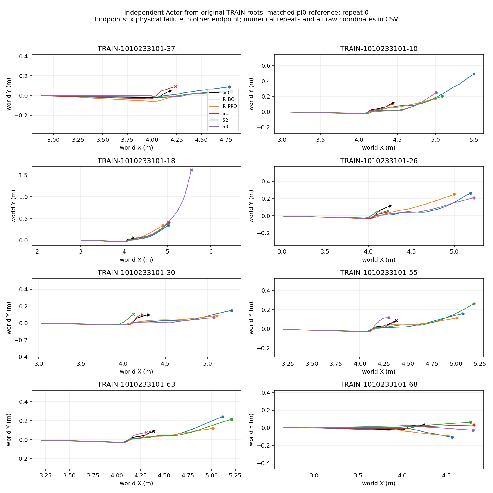

# FrontierBridge R-first / dual-teacher S: actual results (2026-10-14)

| Model | Original TRAIN roots (three repeats per root) | Teacher-verified SOLVER_DEV roots |
|---|---:|---:|
| Frozen pi0 | 0/8 | historical baseline in source panel |
| R, demo-only BC2000 | 7/8 | 1/3 |
| R, curriculum PPO640000 | 7/8 | not evaluated |
| S1, step4 queries | 2/8 | not evaluated |
| S2, initial-state queries | 6/8 | 2/3 |
| S3, step1 queries + verified history | 5/8 | 3/3 |

R PPO replaced failed root10 with success but lost root37; total remained7/8. S3 root18 repeats are0/0/timeout; do not relabel the timeout as a stable physical failure. SOLVER_DEV is a previously-used development panel, excluded from training and teacher label generation. These repeats measure numerical consistency, not independent training seeds.

S2 versus the19 old conditions where archived pi0 passed all six repeats:10 retained,8 lost,1 unresolved. S3:11 retained,7 lost,1 unresolved. Fourteen other old conditions lack stable positive pi0 reference. Nominal pi0 repeats are1/1/1/0/0/1; nominal retention remains unverified. Detailed first-three-versus-all-six accounting is preserved. No automatic model adoption and no final TEST.

R is genuine no-keep BC then demo-assisted fresh-critic PPO; separate Actor/Critic Adam/clipping,1600 updates each, frozen normalizer. Curriculum uses40 complete states generated by128 actual G-action replay transitions,16→12→8→4→0; remaining original400-step clock is preserved. Root37 numerical replay differs from historical trace(max76D error6.27014),root68 .00625,other6 roots0: these are new physical replay states, not historical bitwise reproduction.

S uses independent same-context full-horizon pi0/R queries on actual S-visited TRAIN states. Fourth-step queries produced6 labels; initial-state queries9; first-step queries11,aggregated with prior verified labels to26. Query timing corrected insufficient early-state coverage; aggregation subsequently exchanged root capabilities and did not improve TRAIN total. Sparse queried-state coverage and old-task losses remain the main unresolved issue. Each S review stage declares fresh BC Adam while preserving complete checkpoint/optimizer/RNG for that stage.

[All per-root labels](root_results.csv), [all three repeats coordinates/rewards](trajectories.csv), [per-step rewards](reward.png), [old-retention S2](S2_retention_summary.json), [old-retention S3](S3_retention_summary.json), [summary](summary.json), [exact checkpoint/config identities](identities.json), [hashes](SHA256SUMS).

Models, full learner states, physics logs and original failure evidence stay server-side. Engineering repairs: remaining-horizon bank binding; reference-bank cache identity; Warp shared-scratch autoreset tracer escape; zero-prefix administrative metric mismatch. Pipeline has finite/identity checks, not scientific gate stops.

Next: broaden S-visited query coverage across early and late recovery steps and stable old contexts, retaining all abstentions and aggregating only verified queried labels. Compare losses and gains separately; inspect actual query success availability before increasing BC/PPO updates. Current candidates are not qualified for adoption.
