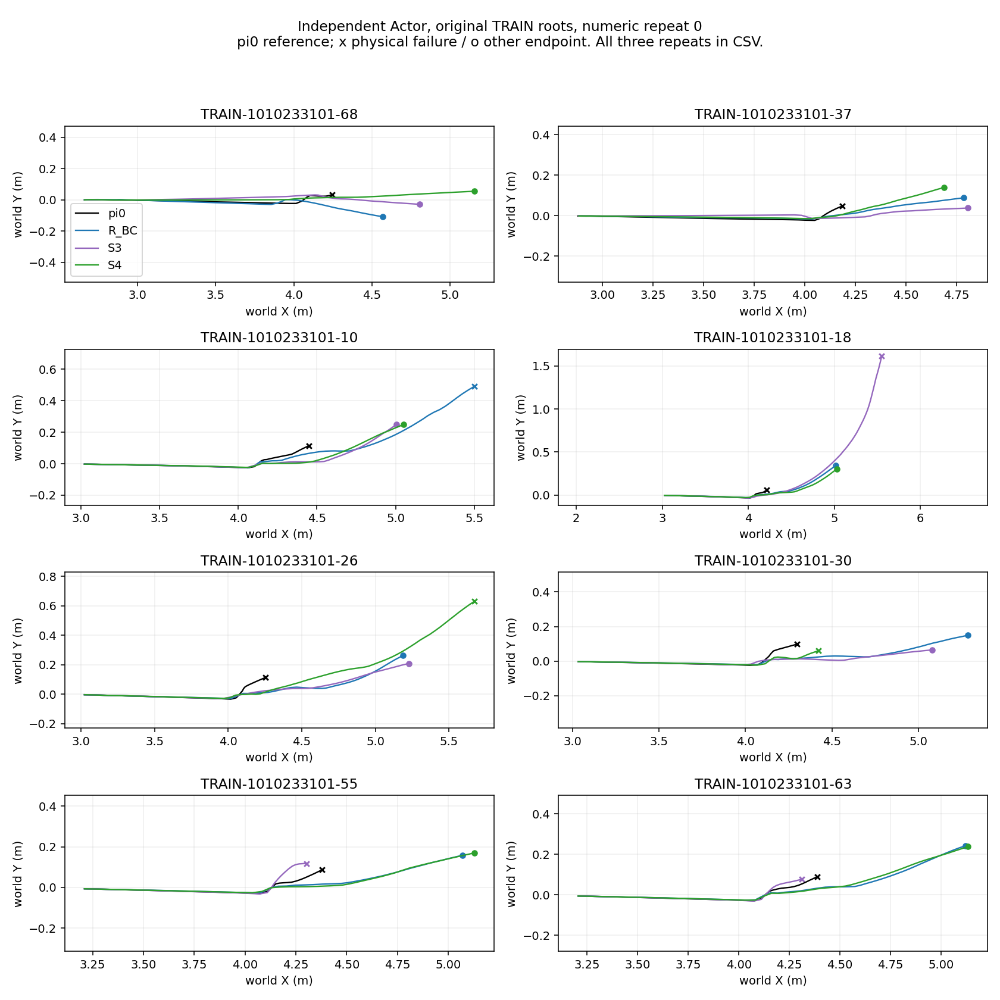

# FrontierBridge：学生教学数据覆盖修正与独立结果

原始世界坐标，等比例；π0 为配对参考策略，不是理想轨迹。各模型由同一原始完整状态独立闭环，图展示数值重复0，三个重复的实际坐标、真实失败/超时及每步奖励见 [trajectories.csv](trajectories.csv)。没有教师驾驶评测。

| 候选 | 原始 TRAIN 根成功 | 同批19个旧稳定条件：保留 / 丢失 / 未定 | 教师确认 DEV |
|---|---:|---:|---:|
| R_BC | 7/8 | 独立恢复专家，不据此主张旧技能保持 | 1/3 |
| R_PPO，累计640000转移 | 7/8 | 成功根发生交换，无净提升 | 未作为本轮学生教师 |
| S2 | 6/8 | 10 / 8 / 1 | 2/3 |
| S3，当前父学生 | 5/8 | 11 / 7 / 1 | 3/3 |
| S4，覆盖修正后 | 6/8 | 14 / 3 / 2 | 2/3 |

19来自同一旧面板的六次数值π0复测均成功条件；另14个旧条件未资格化，不能与历史28分母横比。每个学生重复三次，不是独立训练种子。名义π0为1/1/1/0/0/1，S4为1/0/0，名义保持仍未验证。S4没有被采用，final TEST未打开。

S4比S3新增成功根18/55/63，丢失26/30；总数净增1，但不能把净增抵消丢失。S4仍在B_11、B_14、C_06丢失旧技能，B_08、C_05混合未定。DEV根18由S3成功变为S4失败。逐例见 [root_results.csv](root_results.csv) 与 [retention_by_case.csv](retention_by_case.csv)。这支持“覆盖修正后本面板遗忘减少”，不能证明少遗忘目标已满足或泛化提升。

## 实际教学数据与修复验证

四个14回合访问批次，每批7个R_BC已学会的新TRAIN根、7个旧起点。旧起点按offset0/7/14/21轮换，覆盖9个TRAIN随机初态、9个TRAIN恢复初态；名义仍只有同一根，累计10次draw，不称10个场景或独立seed。新旧各50%之外，再按旧类别和根平衡；权重不代表物理覆盖充分。

冻结同一个S3独立驾驶，在访问步0/1/2/4/8/12/16进行392次真实状态查询。π0/R1分别执行同完整状态、原始剩余horizon的独立三次数值分支；π0优先，未定/超时/双失败放弃标签。316条分支通过，2条同观测但动作差0.3123的名义冲突标签被隔离，最终使用314条：新恢复158、名义58、旧恢复57、旧随机41；选π0 205条、选R 109条。实际每个旧根保留了多少π0/R标签见 [label_coverage.csv](label_coverage.csv)，全部查询和放弃情况见 [query_audit.csv](query_audit.csv)。没有直接复用旧S1–S3的26条标签。

156条旧任务标签实际选择π0 149条、R 7条；TRAIN_RANDOM-19只有2条R标签、没有通过核验的π0标签。名义58条仍来自一个根，类别平衡使其合计权重1/6，不能称名义场景覆盖丰富。旧随机/恢复各九个根参与查询，也不代表每个根都有充分π0监督，更不等于19个评价条件全部成为TRAIN数据。DEV条件未用来监督。

终止后冻结世界、不再生成查询的修复已用于这轮重跑。离线检查全部保存的访问mask无复活，inactive观测/qpos保持冻结，标签重新通过教师receipt身份/哈希/目标审计。所有0–16步访问仍存活，故本轮访问轨迹的终止后冻结检查是空覆盖；不能仅凭此声称实际验证了晚段终止冻结。原始失败日志保留，历史查询没有被事后标成安全。旧访问记录缺少逐步终止链，不能可靠恢复终止历史，旧26条不进入新bank；S3作为初始化仍承接历史训练影响。本轮同时改变覆盖、标签处理和数据量，不能把遗忘减少单独归因于终止修复。

这次实际查询phase0=364、phase1=28；有效标签phase分布见 [summary.json](summary.json)。第16步不等于恢复后段，绝大部分仍是上游。本轮尚不支持“早中后段充分覆盖”。用户最新要求之后，仅补采24/40/80/120/200/320步的数据；不追加R PPO，也不再增加S监督更新，结果另附coverage审计。

S4的BC2000是这条已授权流水线在用户最新“先别增加轮数”消息前已经完成的单次复核，fresh Adam从S3开始；现在不追加训练。BC低loss不等于独立闭环成功。保存0/100/500/1000/2000检查点以及Adam/RNG；原模型、全量分支、完整状态和日志留服务器。

## 身份、成本与运行修复

查询源码38c28d10，按块进程隔离恢复源码d8521e11；输入/最终checkpoint/教师身份见 [identities.json](identities.json)。最终推理checkpoint SHA256为1405bc020dbdba357c57d4223aa143a62a9681ab1767ea2bbab622783ecaa04e。

已知教师查询成本197344转移，学生访问2408转移；原进程因RAM/交换区压力停在18个完整块，保留已完成数据，仅重试未完成块。中断块无法精确回收实际成本，另计最坏33600转移储备，已知+储备230944低于声明940800。只停止自身进程，未干扰其他实验。按块新进程解决内存累计，方法、教师、物理和成功标准没有改变。

全阶段约3409秒，finish阶段358秒；后者不是端到端耗时。TensorBoard [6060](http://127.0.0.1:6060)已核实加载当前S_BC/supervised_reward至2000；原query曲线停在18块，28块完成以receipt/status为准，不能冒充曲线已齐。正常完成通知已送达。

[每步奖励图](reward.png)、[机器可读汇总](summary.json)、[来源身份](identities.json)、[SHA256](SHA256SUMS)。结果图与CSV由原始保存数据重绘，零新增仿真。可恢复完整产物：`/home/qy/DVGC/JIT/runs/experiments/frontierbridge_student_dense_20261014/`。

## 零更新的中后段补采：已完成

在用户最新要求之后，冻结同一个S3，按旧offset0/14补采24/40/80/120/200/320步，共12/12块完成，S更新0、R PPO0。用时650秒，教师实际16556转移，低于声明403200；原始数据在 `/home/qy/DVGC/JIT/runs/experiments/frontierbridge_student_query_coverage_20261014/`。这批标签单独保存，未合并入训练，不代表S4能力再提高。

| 学生访问步 | 实际查询 | 有效标签 |
|---|---:|---:|
| 24 | 28 | 23 |
| 40 | 24 | 21 |
| 80 | 4 | 2 |
| 120 / 200 / 320 | 0 | 0 |

56次查询产生46条有效标签：新恢复18、名义12、旧恢复10、旧随机6；phase0有效10、phase1有效36。40次双教师成功、6次仅π0成功、10次双失败；没有仅R成功状态。46条均选π0，这是优先规则的结果，不意味着R在晚段均失败。后期标签有覆盖增长，但旧根只取了两个offset的子集，未覆盖所有旧根的每个阶段。

具体恢复窗口：S3访问根18在24步时π0成功、R失败，到40/80步双失败；根26/30在24步π0可救，到40步双教师可救；根55/63在24步双失败，40步已无可查询状态。这些是S3访问分布的局部见证，不可直接当S4当前分布，更不能用两个重复批次当独立训练seed。

120步以后均无非终止状态，故没有伪造晚段标签。保存的mask将成功完成和done一起屏蔽，不能把“全部终止”解释为“全部失败”。本轮确实包含inactive轨迹，已逐帧核验inactive观测/qpos冻结、mask不复活，终止后状态不生成查询。原始三分支重复与上下文身份仍保留。

[晚段逐查询审计](late_query_audit.csv)、[逐块空覆盖/成本](late_query_blocks.csv)、[晚段汇总与终止检查](late_query_summary.json)。审计脚本 [audit_late_queries.py](audit_late_queries.py) 与 [rebuild.py](rebuild.py) 只读取原始产物，不执行仿真。36个skill-transfer相关测试和22个device/pulse测试通过，共58项；overflow保护测试中的预期数值溢出warning保留。

下一步优先对S4重新采集可救窗口内的TRAIN访问状态，关注回退根26/30及缺少π0标签的旧根；对55/63避免把查询延后到双教师都救不回的位置。先审计覆盖与可用教师，再声明下一次有界训练配置，不自动增加训练轮数或R PPO，不使用DEV失败场景生成监督标签。
